# 2.1 Car Price Prediction Project

**Chapter 2: Machine Learning for Regression**

- Lesson video: https://www.youtube.com/watch?v=vM3SqPNlStE&list=PL3MmuxUbc_hIhxl5Ji8t4O6lPAOpHaCLR&index=12
- Slides: https://www.slideshare.net/AlexeyGrigorev/ml-zoomcamp-21-car-price-prediction-project
- Course notes: https://github.com/DataTalksClub/machine-learning-zoomcamp/blob/main/02-regression/01-car-price-intro.md
- Dataset (Kaggle): https://www.kaggle.com/CooperUnion/cardataset
- Code and data: https://github.com/alexeygrigorev/mlbookcamp-code/tree/master/chapter-02-car-price

---

## 1. What is this project about?

We build a model that **predicts the price of a car** from its characteristics (make, model, year, engine power, fuel type, transmission, etc.).

Imagine a website where a user lists a car for sale. The site can suggest a fair price automatically. That suggestion comes from our model.

This is a **supervised learning** problem:

- We have historical data where the answer (the price) is already known.
- The model learns the relationship between car characteristics and price.
- Later we use it on new cars where the price is unknown.

Because the thing we predict is a **number** (price in dollars), this is a **regression** problem.

---

## 2. Project plan

| Step | What we do |
|------|-----------|
| 1 | Prepare the data and do Exploratory Data Analysis (EDA) |
| 2 | Use linear regression to predict price |
| 3 | Understand the internals of linear regression |
| 4 | Evaluate the model with RMSE |
| 5 | Feature engineering |
| 6 | Regularization |
| 7 | Use the model to make predictions |

Each step maps to the next lessons of chapter 2.

---

## 3. Key terms explained

**Regression**
A type of supervised learning where the target is a continuous number (price, temperature, salary). Compare with classification, where the target is a category (spam / not spam).

**Linear regression**
A model that predicts the target as a weighted sum of the features. In simple form:

```
price = w0 + w1 * year + w2 * horsepower + w3 * mileage + ...
```

The model learns the weights (`w0`, `w1`, ...) from the data.

**Features (X)**
The input columns used for prediction, such as year, engine HP, number of doors.

**Target (y)**
The value we want to predict. Here it is `MSRP` (Manufacturer's Suggested Retail Price).

**EDA (Exploratory Data Analysis)**
Looking at the data before modelling: checking columns, missing values, distributions, outliers, and relationships. It tells us how to clean the data and what to expect.

**RMSE (Root Mean Squared Error)**
A metric to measure how wrong the model is, in the same units as the target. Formula:

```
RMSE = sqrt( (1/n) * sum( (prediction_i - actual_i)^2 ) )
```

Lower is better. An RMSE of 3000 means predictions are typically off by roughly 3000 dollars.

**Feature engineering**
Creating new, more useful features from existing ones. Example: turn `year` into `age = 2017 - year`.

**Regularization**
A technique that stops the model weights from becoming too large. It reduces overfitting and keeps the model stable, especially when features are correlated.

**Overfitting**
When a model memorizes the training data (including noise) and performs badly on new data.

---

## 4. Setting up the environment

Install the libraries (run once in a terminal):

```
pip install numpy pandas matplotlib seaborn scikit-learn jupyter
```

Start Jupyter:

```
jupyter notebook
```

Create a new notebook and start with the imports:

```python
import pandas as pd
import numpy as np

import seaborn as sns
from matplotlib import pyplot as plt

%matplotlib inline
```

What each library does:

- `pandas`: tables (DataFrames), reading CSV files, cleaning data
- `numpy`: fast numerical arrays and math
- `matplotlib` and `seaborn`: plotting
- `%matplotlib inline`: show plots directly inside the notebook

---

## 5. Getting the dataset

Download the CSV file directly:

```
wget https://raw.githubusercontent.com/alexeygrigorev/mlbookcamp-code/master/chapter-02-car-price/data.csv
```

If `wget` is not available (for example on Windows), load it straight from the URL in Python:

```python
url = "https://raw.githubusercontent.com/alexeygrigorev/mlbookcamp-code/master/chapter-02-car-price/data.csv"
df = pd.read_csv(url)
```

Or, if you downloaded the file next to your notebook:

```python
df = pd.read_csv("data.csv")
```

---

## 6. First look at the data

```python
# Number of rows and columns
df.shape
```

```python
# First 5 rows
df.head()
```

```python
# Column names, data types, and non-null counts
df.info()
```

Expected columns in this dataset include:

- `Make`, `Model`, `Year`
- `Engine Fuel Type`, `Engine HP`, `Engine Cylinders`
- `Transmission Type`, `Driven_Wheels`, `Number of Doors`
- `Market Category`, `Vehicle Size`, `Vehicle Style`
- `highway MPG`, `city mpg`, `Popularity`
- `MSRP` (the target)

---

## 7. Key takeaways

- The goal is to predict car price (`MSRP`), which makes this a **regression** problem.
- The dataset comes from a Kaggle competition and has car characteristics as features.
- The plan: prepare data and EDA, linear regression, how it works internally, RMSE, feature engineering, regularization, and using the model.
- Tools used: `pandas`, `numpy`, `matplotlib`, `seaborn`, and later `scikit-learn`.

---

## 8. Navigation

- Previous: Chapter 1 intro
- Next: 2.2 Data preparation

# 2.2 Data Preparation

**Chapter 2: Machine Learning for Regression**

- Lesson video: https://www.youtube.com/watch?v=Kd74oR4QWGM&list=PL3MmuxUbc_hIhxl5Ji8t4O6lPAOpHaCLR&index=13
- Course notes: https://github.com/DataTalksClub/machine-learning-zoomcamp/blob/main/02-regression/02-data-preparation.md
- Dataset: https://github.com/alexeygrigorev/mlbookcamp-code/tree/master/chapter-02-car-price

---

## 1. Goal of this lesson

Before any modelling we need clean, consistent data. In this lesson we:

1. Download the car price dataset
2. Load it with pandas
3. Make the **column names** consistent (lowercase, no spaces)
4. Find the **string columns**
5. Make the **string values** consistent (lowercase, no spaces)

Inconsistent names and values cause bugs and make the code harder to write, so this small cleanup pays off for the rest of the chapter.

---

## 2. Terms explained

**DataFrame**
The main pandas table structure: rows and named columns, like a spreadsheet or SQL table in memory.

**Series**
A single column of a DataFrame (a labelled 1-D array).

**Index**
The labels of a Series or DataFrame. `df.columns` is also an Index object, holding the column names.

**dtype (data type)**
The type of values stored in a column, such as `int64`, `float64`, or `object`.

**object dtype**
How pandas stores strings. When a column loaded from a CSV has dtype `object`, it is effectively a text column.

**`.str` accessor**
A pandas namespace that lets you apply string functions (`lower`, `replace`, `strip`, ...) to a whole column at once, without writing a loop.

**Method chaining**
Calling several methods one after another on the result of the previous one, for example `.str.lower().str.replace(...)`.

**Boolean mask**
A True/False series used to filter data. Example: `df.dtypes == 'object'` gives True for every text column.

---

## 3. Getting the data

The dataset originates from Kaggle, but a copy is stored in the `mlbookcamp-code` repository. Download it with `wget`:

```python
data = 'https://raw.githubusercontent.com/alexeygrigorev/mlbookcamp-code/master/chapter-02-car-price/data.csv'
!wget $data
```

Notes:

- The `!` at the start runs a shell command from inside a Jupyter notebook.
- `$data` passes the Python variable into the shell command.
- The file `data.csv` is saved in the current working directory.
- If `wget` is not available (for example on Windows), skip the download and read directly from the URL: `pd.read_csv(data)`.

---

## 4. Loading the data

```python
import pandas as pd

df = pd.read_csv('data.csv')
```

`read_csv` reads the file and returns a DataFrame. Always look at the first rows right after loading:

```python
df.head()
```

You will see columns such as make, model, year, engine details, and **MSRP** (Manufacturer's Suggested Retail Price). MSRP is our **target**, the value we want to predict.

---

## 5. Making column names consistent

### The problem

The raw column names are inconsistent:

- Some have capital letters: `Make`, `Model`
- Some have spaces: `Engine Fuel Type`
- Some use underscores: `Driven_Wheels`

Spaces are the worst. You cannot use dot notation with them:

```python
# This is a syntax error
df.Transmission Type

# You are forced to use brackets instead
df['Transmission Type']
```

With clean names like `transmission_type`, you can write `df.transmission_type`.

### The fix

`df.columns` is an Index, and an Index supports the `.str` accessor, so we can transform all names at once:

```python
df.columns.str.lower()
```

Chain a second step to replace spaces with underscores:

```python
df.columns.str.lower().str.replace(' ', '_')
```

Result:

```
Index(['make', 'model', 'year', 'engine_fuel_type', 'engine_hp',
       'engine_cylinders', 'transmission_type', 'driven_wheels',
       'number_of_doors', 'market_category', 'vehicle_size', 'vehicle_style',
       'highway_mpg', 'city_mpg', 'popularity', 'msrp'],
      dtype='object')
```

### Important: save the result

The expression above only **returns** a new Index. The DataFrame is unchanged until you assign it back:

```python
df.columns = df.columns.str.lower().str.replace(' ', '_')
```

---

## 6. Finding the string columns

Values have the same inconsistency problem (for example `BMW` vs `bmw`, `MANUAL` vs `manual`). To clean them we first need to know which columns contain text, because string methods fail on numbers.

Check the data types:

```python
df.dtypes
```

Filter to the text columns using a boolean mask:

```python
df.dtypes[df.dtypes == 'object']
```

This returns a Series where the index holds the column names and the values are all `object`. We only need the names, so take the index and convert it to a list:

```python
strings = list(df.dtypes[df.dtypes == 'object'].index)
strings
```

Result:

```
['make',
 'model',
 'engine_fuel_type',
 'transmission_type',
 'driven_wheels',
 'market_category',
 'vehicle_size',
 'vehicle_style']
```

---

## 7. Normalizing the string values

Loop over the string columns and apply the same lowercase and underscore transformation. Assign the result back to the DataFrame:

```python
for col in strings:
    df[col] = df[col].str.lower().str.replace(' ', '_')
```

Check the result:

```python
df.head()
```

Now everything is lowercase and spaces inside values (for example `premium unleaded (required)`) become underscores.

---

## 8. Full code of the lesson in one place

```python
import pandas as pd

# 1. Load
data = 'https://raw.githubusercontent.com/alexeygrigorev/mlbookcamp-code/master/chapter-02-car-price/data.csv'
df = pd.read_csv(data)

# 2. Clean column names
df.columns = df.columns.str.lower().str.replace(' ', '_')

# 3. Find text columns
strings = list(df.dtypes[df.dtypes == 'object'].index)

# 4. Clean text values
for col in strings:
    df[col] = df[col].str.lower().str.replace(' ', '_')

df.head()
```

---

## 9. Pandas cheat sheet from this lesson

| Code | What it does |
|------|--------------|
| `pd.read_csv(path)` | Read a CSV file into a DataFrame |
| `df.head()` | Show the first 5 rows |
| `df.columns` | Get the column names |
| `df.columns.str.lower()` | Lowercase all column names |
| `df.columns.str.replace(' ', '_')` | Replace spaces with underscores |
| `df.dtypes` | Get the data type of every column |
| `df.index` | Get the row labels of the DataFrame |

---

## 10. Key takeaways

- Clean names and values early. It prevents annoying bugs later.
- Use lowercase and underscores everywhere (snake_case) so you can use dot notation.
- The `.str` accessor applies string operations to a whole column without loops.
- String operations return a new object. You must assign it back (`df[col] = ...`) to keep the change.
- In pandas, text columns have dtype `object`.
- Selecting columns by dtype is done with a boolean mask on `df.dtypes`.

---

## 11. Navigation

- Previous: 2.1 Car price prediction project
- Next: 2.3 Exploratory data analysis (EDA)

# 2.3 Exploratory Data Analysis (EDA)

**Chapter 2: Machine Learning for Regression**

- Lesson video: https://www.youtube.com/watch?v=k6k8sQ0GhPM&list=PL3MmuxUbc_hIhxl5Ji8t4O6lPAOpHaCLR&index=14
- Slides: https://www.slideshare.net/AlexeyGrigorev/ml-zoomcamp-2-slides
- Course notes: https://github.com/DataTalksClub/machine-learning-zoomcamp/blob/main/02-regression/03-eda.md
- Full notebook: https://github.com/alexeygrigorev/mlbookcamp-code/blob/master/chapter-02-car-price/02-carprice.ipynb

---

## 1. Goal of this lesson

EDA means looking carefully at the data **before** training a model. We want to know:

- What values do the columns contain?
- How many distinct values does each column have?
- What does the **target** (`msrp`) distribution look like?
- Are there **missing values**?

The most important finding in this lesson: the price distribution has a **long tail**, and we should fix that with a **log transformation** before modelling.

### Diagram: EDA workflow

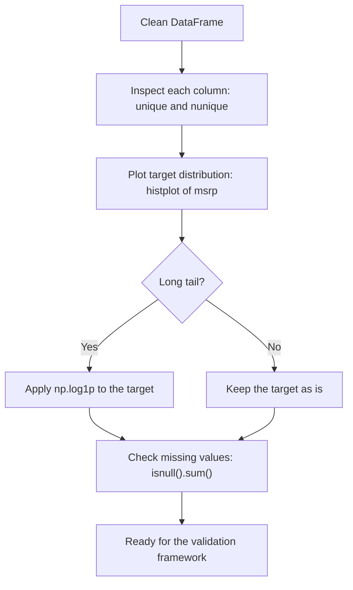

---

## 2. Terms explained

**EDA (Exploratory Data Analysis)**
Summarizing and visualizing a dataset to understand its structure, quality, and patterns before modelling.

**Target variable**
The value we want to predict. Here it is `msrp`.

**Distribution**
How the values of a variable are spread out: where most values lie, how spread out they are, and whether there are extreme values.

**Histogram**
A bar chart that groups values into ranges (bins) and shows how many observations fall in each bin.

**Long tail (skewed distribution)**
Most values are concentrated in a small range, but a few very large values stretch the distribution far to one side. Car prices are like this: most cars cost a few thousand to a few tens of thousands of dollars, while a few luxury cars cost over a million.

**Normal distribution**
The symmetric bell-shaped curve. Many ML models, linear regression included, work better when the target looks roughly like this.

**Log transformation**
Replacing each value `x` with `log(x)`. It compresses large values much more than small ones, so a long tail becomes a more symmetric shape.

**Null / missing value (NaN)**
An empty cell, meaning the value is unknown. We must detect these and deal with them before training.

**Bins**
The number of intervals a histogram uses. More bins give a more detailed picture.

---

## 3. Setup (from the previous lessons)

```python
import pandas as pd
import numpy as np

import seaborn as sns
from matplotlib import pyplot as plt

%matplotlib inline

df = pd.read_csv('data.csv')

df.columns = df.columns.str.lower().str.replace(' ', '_')

strings = list(df.dtypes[df.dtypes == 'object'].index)
for col in strings:
    df[col] = df[col].str.lower().str.replace(' ', '_')
```

`%matplotlib inline` makes sure plots are displayed inside the notebook cell.

---

## 4. Looking at each column

### Unique values and counts

For every column, look at a few unique values and how many there are in total:

```python
for col in df.columns:
    print(col)
    print(df[col].unique()[:5])
    print(df[col].nunique())
    print()
```

What the methods do:

- `df[col].unique()` returns an array of the distinct values in the column
- `[:5]` takes only the first 5 so the output stays readable
- `df[col].nunique()` returns the **number** of distinct values

Why this is useful:

- A column with very few unique values (for example `transmission_type`) is **categorical**.
- A column with many unique values (for example `msrp`, `popularity`) is **numerical**.
- Columns like `year` or `number_of_doors` are numbers but have few values. We will treat them carefully later.

---

## 5. Distribution of the target (price)

### Plot the histogram

```python
sns.histplot(df.msrp, bins=50)
```

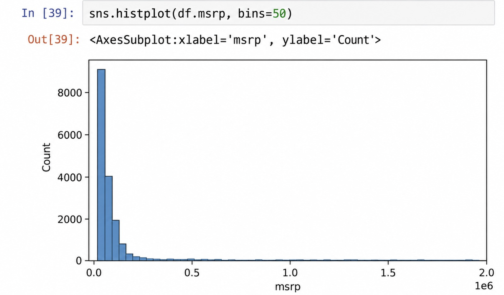

You will see a very tall bar at the left (cheap cars) and a thin line stretching far to the right (expensive cars). That is the **long tail**.

### Zoom into the main part

To see the bulk of the data more clearly, plot only cars below 100,000:

```python
sns.histplot(df.msrp[df.msrp < 100000], bins=50)
```
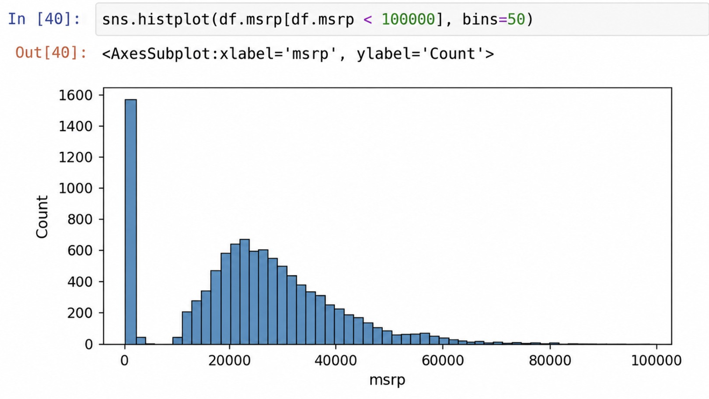


Even this zoomed view is still skewed and not a bell shape. The extreme values are the real problem, not just the way we plot.

### Why the long tail is a problem

- A few very expensive cars dominate the error calculation.
- The model tries hard to fit these rare values and does worse on the typical cars.
- Linear regression behaves better when the target is roughly normal.

---

## 6. Log transformation

Apply a logarithm to the price to squeeze the large values:

```python
price_logs = np.log(df.msrp)
```

Problem: `log(0)` is undefined. If any price is 0 this breaks. The safe approach is `log1p`, which computes `log(x + 1)`:

```python
price_logs = np.log1p(df.msrp)
```

Plot it:

```python
sns.histplot(price_logs, bins=50)
```

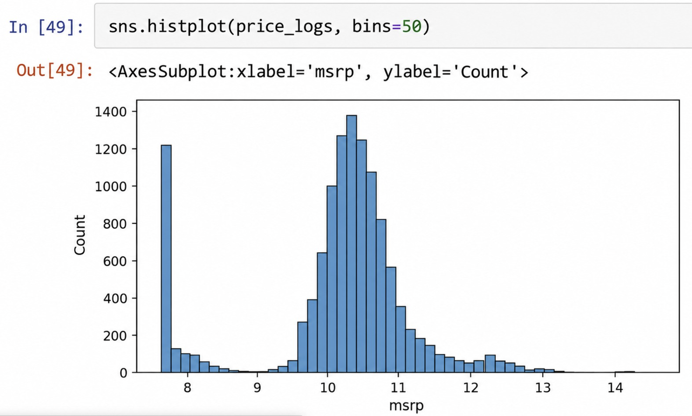

The long tail is gone and the shape is much closer to a normal bell curve.

### Diagram: effect of the log transformation

The image below uses **synthetic data** to illustrate the idea. Your real histogram of `msrp` will look similar in shape: a tall bar on the left and a thin tail to the right, which becomes a bell shape after `log1p`.

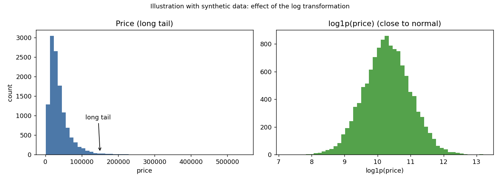

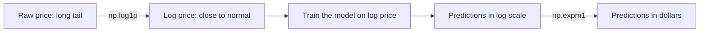

### Quick intuition

| Price | log1p(price) |
|-------|--------------|
| 1,000 | about 6.9 |
| 10,000 | about 9.2 |
| 100,000 | about 11.5 |
| 1,000,000 | about 13.8 |

A 1000x difference in price becomes only about a 7-point difference in log scale. Large values are compressed, small values are barely changed.

### Important for later

If we train the model on the **log price**, its predictions are also log prices. To get real dollars back, we reverse the transformation with `np.expm1()`:

```python
price = np.expm1(price_logs)
```

We will use this when we train and evaluate the model.

---

## 7. Missing values

Count the missing values per column:

```python
df.isnull().sum()
```

How it works:

- `df.isnull()` gives a table of True/False (True where the value is missing)
- `.sum()` adds up the True values per column, because True counts as 1

In this dataset a few columns have missing values (for example `engine_hp`, `engine_cylinders`, `number_of_doors`, `market_category`). We will handle them in the next lessons, since linear regression cannot work with NaN.

---

## 8. Cheat sheet from this lesson

| Code | What it does |
|------|--------------|
| `df[col].unique()` | Distinct values of a column |
| `df[col].nunique()` | Number of distinct values |
| `df.isnull().sum()` | Number of missing values per column |
| `sns.histplot(series, bins=50)` | Histogram of a series |
| `%matplotlib inline` | Show plots inside the notebook |
| `np.log1p(x)` | log(x + 1), safe log transform |
| `np.expm1(x)` | Inverse of log1p, back to the original scale |

---

## 9. Key takeaways

- Always do EDA before modelling. Look at values, unique counts, the target distribution, and missing values.
- Car prices have a **long tail**. This confuses many ML models.
- Apply **log1p** to the target to make its distribution closer to normal.
- Use `log1p` instead of `log` so a value of 0 does not break the code.
- Remember to convert predictions back with `expm1` when you need real prices.
- Check for missing values with `df.isnull().sum()`. We must deal with them before training.

---

## 10. Navigation

- Previous: 2.2 Data preparation
- Next: 2.4 Setting up the validation framework

# 2.4 Setting up the Validation Framework

**Chapter 2: Machine Learning for Regression**

- Lesson video: https://www.youtube.com/watch?v=ck0IfiPaQi0&list=PL3MmuxUbc_hIhxl5Ji8t4O6lPAOpHaCLR&index=15
- Course notes: https://github.com/DataTalksClub/machine-learning-zoomcamp/blob/main/02-regression/04-validation-framework.md

---

## 1. Goal of this lesson

The data is cleaned and explored. Before training anything, we split it into three parts and prepare the inputs and targets for each part. We do everything by hand with plain pandas and NumPy, with no ML library.

By the end we will have:

- `df_train`, `df_val`, `df_test`: the three feature tables
- `y_train`, `y_val`, `y_test`: the three target arrays (log of price)

### Diagram: lesson workflow

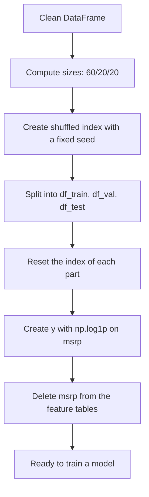

---

## 2. Terms explained

**Training set**
The data the model learns from. Biggest part (60%).

**Validation set**
Data the model does not train on. We use it to check how well the model works on unseen data and to compare different models or settings. We can look at it as often as we like.

**Test set**
Data kept aside until the very end. It gives a final, honest estimate of performance. We use it rarely, because every time we peek and adjust our model, it becomes a little less "unseen".

**Feature matrix (X)**
The table of input columns used to make predictions.

**Target (y)**
The value to predict. Here: the log of the car price.

**Generalization**
How well a model performs on data it has not seen. This is what we really care about, and why we validate.

**Data leakage**
When information that should not be available at prediction time gets into the features. If `msrp` stays in X, the model "predicts" the price using the price, and looks perfect for the wrong reason.

**Random seed**
A number that fixes the random generator, so the shuffle gives the same result every run. This makes experiments reproducible.

**Index (pandas)**
The row labels of a DataFrame. After shuffling, the labels are in random order and no longer run 0, 1, 2, ...

---

## 3. Why three parts?

If we trained and evaluated on the same data, a model could simply memorize the answers and look great while being useless on new cars. So we hold data back.

### Diagram: roles of the three parts

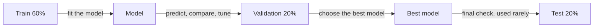

Each part gets its own X and y:

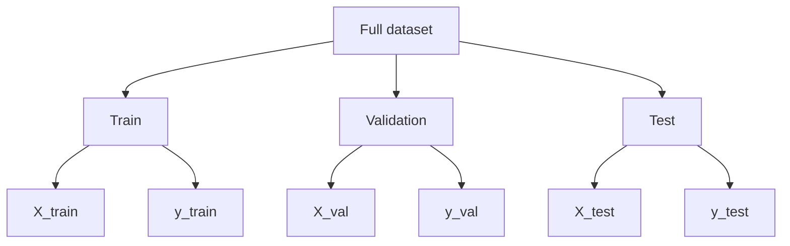

---

## 4. Calculating the sizes of the parts

We use a **60/20/20** split. The dataset has 11,914 rows, so 20% is about 2,382.8. We need whole numbers, so we cut the fraction with `int()`:

```python
n = len(df)

n_val = int(n * 0.2)
n_test = int(n * 0.2)
n_train = n - n_val - n_test
```

Why not `n_train = int(n * 0.6)`? Because of rounding, the three sizes might not add up to `n`, and we could silently drop a few rows. Taking validation and test first, and giving the rest to train, guarantees every row is used.

```python
n, n_val, n_test, n_train
```

Output:

```
(11914, 2382, 2382, 7150)
```

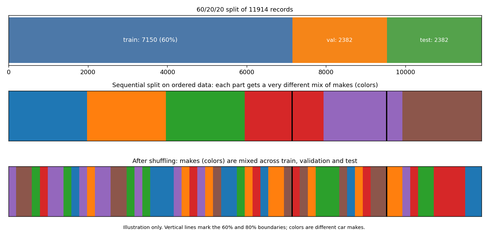

The picture is an illustration with made-up data. The top bar shows the real sizes.

---

## 5. Slicing a DataFrame with iloc

`iloc` selects rows by **position**. It accepts a single number, a list of numbers, or a slice:

```python
df.iloc[:10]     # rows 0 to 9 (end is not included)
df.iloc[10:20]   # rows 10 to 19
df.iloc[10:]     # row 10 until the end
```

The simplest split is sequential:

```python
df_val = df.iloc[:n_val]
df_test = df.iloc[n_val:n_val+n_test]
df_train = df.iloc[n_val+n_test:]
```

### The problem with a sequential split

In this dataset the rows are ordered (for example by car make). A sequential split puts a block of makes in validation and a different block in train. The parts then look very different from each other, which makes validation results misleading. Always **shuffle** first, so any accidental order in the data cannot affect the split.

---

## 6. Shuffling the records

`iloc` also accepts an arbitrary list of positions and returns rows in that order. So the idea is:

1. Make an array of positions `0 ... n-1`
2. Shuffle it
3. Take the first part for train, the next for validation, the rest for test

```python
import numpy as np

idx = np.arange(n)
np.random.shuffle(idx)
```

Then index with the shuffled positions:

```python
df_train = df.iloc[idx[:n_train]]
df_val = df.iloc[idx[n_train:n_train+n_val]]
df_test = df.iloc[idx[n_train+n_val:]]
```

### Make it reproducible

Without a seed, every run gives a different split, so your numbers will differ from run to run and from other people's. Set the seed **before** shuffling:

```python
np.random.seed(2)

idx = np.arange(n)
np.random.shuffle(idx)
```

With seed 2 and the same NumPy version, you should get the same subsets as the course.

### Diagram: shuffled split

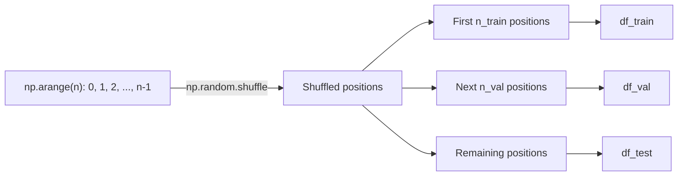

---

## 7. Resetting the index

Check the sizes:

```python
len(df_train), len(df_val), len(df_test)
```

Output:

```
(7150, 2382, 2382)
```

After shuffling, each DataFrame keeps its **original** row labels in random order (for example 2735, 6720, ...). We don't need them, so reset to 0, 1, 2, ... and assign the result back:

```python
df_train = df_train.reset_index(drop=True)
df_val = df_val.reset_index(drop=True)
df_test = df_test.reset_index(drop=True)
```

`drop=True` means "throw the old index away". Without it, the old labels would be added as a new column.

---

## 8. Preparing y and removing msrp

### Create the targets

We apply `log1p` because of the long tail (lesson 2.3). `.values` converts the pandas Series to a NumPy array, since we no longer need pandas features for y:

```python
y_train = np.log1p(df_train.msrp.values)
y_val = np.log1p(df_val.msrp.values)
y_test = np.log1p(df_test.msrp.values)
```

### Remove the target from the features

```python
del df_train['msrp']
del df_val['msrp']
del df_test['msrp']
```

Why delete it? To avoid **data leakage** by accident. If `msrp` is left among the features, the model uses the price to predict the price and looks perfect. You could waste a lot of time figuring out what went wrong.

### Diagram: what leakage looks like

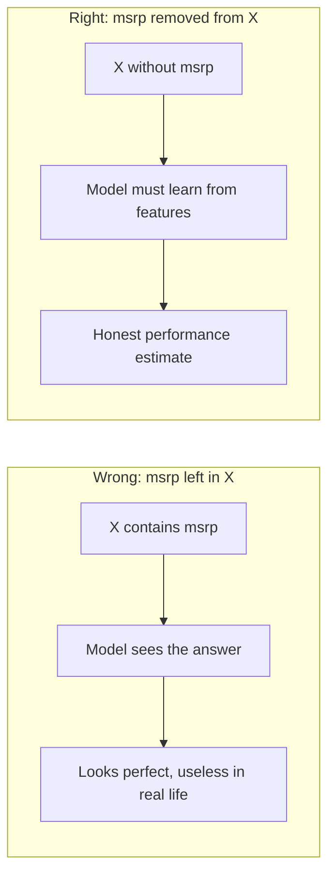

---

## 9. Full code of the lesson

```python
import numpy as np

# 1. Sizes
n = len(df)
n_val = int(n * 0.2)
n_test = int(n * 0.2)
n_train = n - n_val - n_test

# 2. Shuffle with a fixed seed
np.random.seed(2)
idx = np.arange(n)
np.random.shuffle(idx)

# 3. Split
df_train = df.iloc[idx[:n_train]]
df_val = df.iloc[idx[n_train:n_train+n_val]]
df_test = df.iloc[idx[n_train+n_val:]]

# 4. Reset the index
df_train = df_train.reset_index(drop=True)
df_val = df_val.reset_index(drop=True)
df_test = df_test.reset_index(drop=True)

# 5. Targets (log of price)
y_train = np.log1p(df_train.msrp.values)
y_val = np.log1p(df_val.msrp.values)
y_test = np.log1p(df_test.msrp.values)

# 6. Remove the target from the features
del df_train['msrp']
del df_val['msrp']
del df_test['msrp']
```

---

## 10. Cheat sheet from this lesson

**Pandas**

| Code | What it does |
|------|--------------|
| `df.iloc[a:b]` | Rows by position, from a up to b (b not included) |
| `df.iloc[list_of_positions]` | Rows in the order given by the list |
| `df.reset_index(drop=True)` | Renumber rows 0, 1, 2, ... and discard the old index |
| `df.col.values` | Convert a Series to a NumPy array |
| `del df['col']` | Remove a column in place |

**NumPy**

| Code | What it does |
|------|--------------|
| `np.arange(n)` | Array 0, 1, ..., n-1 |
| `np.random.shuffle(arr)` | Shuffle an array in place |
| `np.random.seed(k)` | Fix the random generator for reproducibility |
| `np.log1p(x)` | log(x + 1) |

---

## 11. Key takeaways

- Split the data into **train / validation / test** (60/20/20 here) before training.
- Train to learn, validation to compare and tune, test only at the very end.
- Give the **remainder** to train so rounding never drops rows.
- **Shuffle** before splitting, in case the data has an accidental order.
- Set a **random seed** so results are reproducible.
- Reset the index after shuffling, and take the target out as `y`.
- Apply `log1p` to the target, and **delete `msrp` from X** to avoid leakage.
- Predictions will be in log scale, so convert back with `np.expm1` when reporting prices in dollars.

---

## 12. Navigation

- Previous: 2.3 Exploratory data analysis
- Next: 2.5 Linear regression (simple version)

# 2.5 Linear Regression (Simple Version)

**Chapter 2: Machine Learning for Regression**

- Lesson video: https://www.youtube.com/watch?v=Dn1eTQLsOdA&list=PL3MmuxUbc_hIhxl5Ji8t4O6lPAOpHaCLR&index=16
- Course notes: https://github.com/DataTalksClub/machine-learning-zoomcamp/blob/main/02-regression/05-linear-regression-simple.md

---

## 1. Goal of this lesson

We look at **linear regression**, the model used to predict numbers such as car prices. In this lesson we:

1. Write the formula for **one car** (one row of data)
2. Implement it in Python with a simple loop
3. See what the final prediction is made of
4. Convert the prediction from log price back to dollars

The weights in this lesson are invented by us. Learning them from data comes in later lessons.

### Diagram: lesson flow

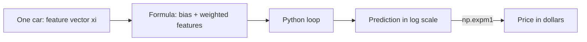

---

## 2. Terms explained

**Model (g)**
A function that takes features and returns a prediction. We write `g(X) ≈ y`: the model applied to the features should be close to the target.

**Observation**
One example, here one car. It corresponds to one row of the feature matrix.

**Feature vector (xi)**
The list of feature values for one car. `xi1` is the first feature of car number `i`, `xi2` the second, and so on.

**Weights (w1, w2, ...)**
One number per feature. A weight says how much that feature pushes the prediction up or down. A bigger weight means a stronger influence.

**Bias term (w0)**
The starting value of the prediction, used before looking at any feature. It is what we would predict for a car if we knew nothing about it.

**Linear**
The prediction is a plain weighted sum: each feature is multiplied by a number and the results are added. No squares, no products between features.

**Vector-vector multiplication (dot product)**
Multiply two lists element by element and add everything up. The sum in the formula is exactly this, which is why a compact vector form exists (next lesson).

**Inverse function**
A function that undoes another one. `np.expm1` undoes `np.log1p`.

---

## 3. The idea in one picture

### Diagram: how the model combines the features

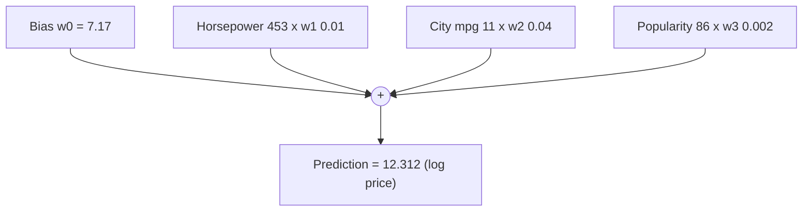

---

## 4. The formula for one car

For one car we write the feature vector as `xi`. Our example is row 10 of the training data, a Rolls-Royce Phantom Drophead Coupe from 2015. We use only three features:

- engine horsepower: 453
- city miles per gallon: 11
- popularity: 86 (number of mentions on Twitter)

```python
xi = [453, 11, 86]
```

The linear regression formula for this car:

$$g(x_i) = w_0 + w_1 \cdot x_{i1} + w_2 \cdot x_{i2} + w_3 \cdot x_{i3}$$

The same thing with a sum over the features (`j` goes from 1 to n, here n = 3):

$$g(x_i) = w_0 + \sum_{j=1}^{n} w_j \cdot x_{ij}$$

Reading it in words: start from the bias, then for every feature multiply it by its weight and add the result.

---

## 5. Implementing it in Python

Here are the parameters. These weights are made up for illustration:

```python
xi = [453, 11, 86]

w0 = 7.17
w = [0.01, 0.04, 0.002]
```

The function:

```python
def linear_regression(xi):
    n = len(xi)

    pred = w0

    for j in range(n):
        pred = pred + w[j] * xi[j]

    return pred
```

How it works:

- `pred` starts at the bias `w0`
- the loop visits each feature, multiplies it by its weight, and adds it to `pred`
- the math formula counts features from 1 to n, but Python counts from 0 to n-1, so `range(n)` is the right loop

Try it:

```python
linear_regression(xi)
```

Output:

```
12.312
```

---

## 6. What is the prediction made of?

The result is a sum of four parts:

```
7.17 + 453 * 0.01 + 11 * 0.04 + 86 * 0.002 = 12.312
```

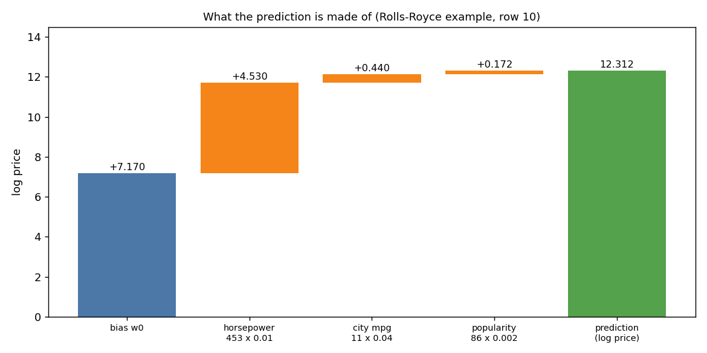

| Part | Calculation | Contribution | Meaning |
|------|-------------|--------------|---------|
| Bias | 7.17 | 7.170 | Prediction when we know nothing about the car |
| Horsepower | 453 x 0.01 | 4.530 | Each extra horsepower adds 0.01. More power, higher price |
| City mpg | 11 x 0.04 | 0.440 | Each extra unit adds 0.04. In this data, thirstier cars tend to be fancier |
| Popularity | 86 x 0.002 | 0.172 | Tiny weight, so it barely moves the price |

Notes on interpreting weights:

- A **positive** weight pushes the prediction up as the feature grows. A negative weight pushes it down.
- A weight only tells you about the relationship in the data. It does not prove that the feature causes the price.
- The size of a contribution depends on both the weight and the feature scale. Popularity has a small weight, but features with big values can still matter.

---

## 7. From log price back to dollars

The number 12.312 is **not** a price in dollars. In lesson 2.3 we trained on `np.log1p(msrp)`, so the model outputs a **log price**. To get dollars, apply the inverse function:

```python
import numpy as np

np.expm1(12.312)
```

Output:

```
222347.2221101062
```

So the predicted price is about 222,000 dollars.

`expm1` and `log1p` undo each other:

```python
np.log1p(222347.2221101062)
```

Output:

```
12.312
```

### Diagram: log scale and back

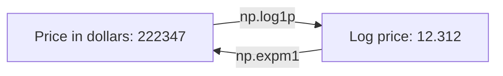

---

## 8. Compact vector form (preview of next lesson)

The sum over features is a **dot product** between the feature vector and the weight vector. So the formula can be written as:

$$g(x_i) = w_0 + x_i^T \cdot w$$

Where:

- `x_i^T` is the feature vector of car i
- `w` is the vector of weights
- the dot product multiplies matching elements and adds them up

The next lesson uses this form to predict for **all cars at once**, with no Python loop.

---

## 9. Full code of the lesson

```python
import numpy as np

xi = [453, 11, 86]

w0 = 7.17
w = [0.01, 0.04, 0.002]

def linear_regression(xi):
    n = len(xi)

    pred = w0

    for j in range(n):
        pred = pred + w[j] * xi[j]

    return pred

pred_log = linear_regression(xi)     # 12.312, in log scale
pred_price = np.expm1(pred_log)      # about 222347, in dollars

print(pred_log, pred_price)
```

---

## 10. Cheat sheet

| Symbol or code | Meaning |
|----------------|---------|
| `g(X) ≈ y` | Model applied to features should be close to the target |
| `xi` | Feature vector of one car |
| `w0` | Bias term |
| `w` | Weights, one per feature |
| `g(xi) = w0 + sum(wj * xij)` | Linear regression for one car |
| `np.expm1(x)` | Inverse of `np.log1p`, converts log price to price |

---

## 11. Key takeaways

- Linear regression predicts a number as **bias + weighted sum of the features**.
- Each weight tells how strongly one feature moves the prediction.
- The bias is the prediction when nothing is known about the car.
- For one car, the formula is a short Python loop over the features.
- Our model predicts **log price**, so we convert with `np.expm1` to get dollars.
- The weights here were made up. Finding good weights from data is the real training step, coming next.

---

## 12. Navigation

- Previous: 2.4 Setting up the validation framework
- Next: 2.6 Linear regression: vector form

# 2.6 Linear Regression: Vector Form

**Chapter 2: Machine Learning for Regression**

- Lesson video: https://www.youtube.com/watch?v=YkyevnYyAww&list=PL3MmuxUbc_hIhxl5Ji8t4O6lPAOpHaCLR&index=17
- Course notes: https://github.com/DataTalksClub/machine-learning-zoomcamp/blob/main/02-regression/06-linear-regression-vector.md

> Formula tip: every formula below is written twice, once as LaTeX (`$$` block) and once as plain text underneath. If your editor does not render math, the plain-text line still reads correctly.

---

## 1. Goal of this lesson

Last lesson we predicted the price of one car with a loop. Now we make it shorter and faster in three steps:

1. Recognize the sum as a **dot product**
2. Hide the bias term inside the dot product with a **fictional feature** that is always 1
3. Predict for **all cars at once** with a **matrix-vector multiplication**

### Diagram: from loop to matrix

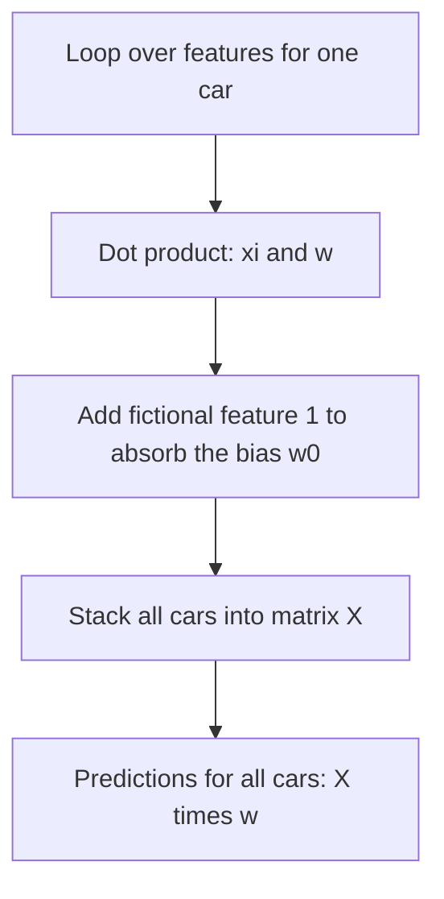

---

## 2. Terms explained

**Dot product**
Multiply two vectors element by element, then add the results. Two vectors of the same length give one number.

**Transpose (T)**
Flip a vector or matrix. In the formula `xi^T w`, the transpose is just the notation that says "dot product of xi and w". In NumPy code you do not need to transpose anything.

**Matrix**
A 2-D table of numbers. Our feature matrix `X` has one row per car and one column per feature.

**Matrix-vector multiplication**
Take each row of the matrix, do the dot product with the vector, and collect the results into a new vector. One result per row.

**Fictional (dummy) feature**
An extra feature `xi0` that equals 1 for every car. It exists only so the bias term can be treated like any other weight.

**Vectorization**
Replacing Python loops with matrix or vector operations. It is shorter, and NumPy runs it much faster.

**Shape**
The size of an array: `(rows, columns)`. Here `X` is (m cars, n+1 columns).

---

## 3. The dot product

Reminder from the last lesson, for one car:

$$
g(x_i) = w_0 + \sum_{j=1}^{n} x_{ij} \cdot w_j
$$

Plain text:

```
g(xi) = w0 + sum over j=1..n of ( xij * wj )
```

The sum is exactly a dot product between the feature vector and the weight vector. So we can write:

$$
g(x_i) = w_0 + x_i^T w
$$

Plain text:

```
g(xi) = w0 + dot(xi, w)
```

### Python: dot product by hand

```python
def dot(xi, w):
    n = len(xi)

    res = 0.0

    for j in range(n):
        res = res + xi[j] * w[j]

    return res
```

Now linear regression becomes very short:

```python
xi = [453, 11, 86]
w0 = 7.17
w = [0.01, 0.04, 0.002]

def linear_regression(xi):
    return w0 + dot(xi, w)
```

---

## 4. The fictional feature

The bias `w0` still sits alone, outside the dot product. The trick: pretend every car has an extra feature `xi0` that is always 1. Then both vectors get one more element at the front:

```
w  = [w0, w1, w2, ..., wn]       (n + 1 values)
xi = [1,  xi1, xi2, ..., xin]    (n + 1 values)
```

Why this works: in the dot product, `w0` is multiplied by 1, so it stays unchanged. The rest is the same sum as before. The result is identical, but the whole formula is now a single dot product:

$$
g(x_i) = x_i^T w
$$

Plain text:

```
g(xi) = dot(xi_with_leading_1, w_with_w0)
```

### Diagram: absorbing the bias

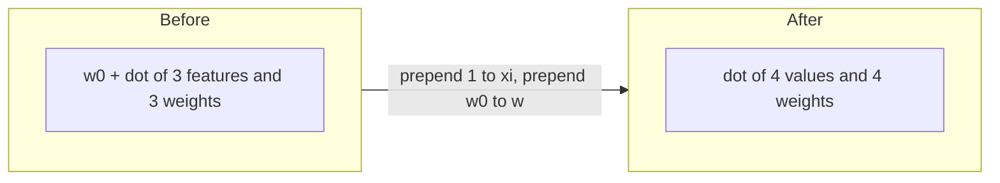

### Python: prepending with list concatenation

In Python, `[a] + list` creates a new list with `a` at the front:

```python
w_new = [w0] + w
w_new
```

Output:

```
[7.17, 0.01, 0.04, 0.002]
```

Same for the features:

```python
def linear_regression(xi):
    xi = [1] + xi
    return dot(xi, w_new)
```

Check:

```python
linear_regression([453, 11, 86])
```

Output:

```
12.312
```

This matches the result from lesson 2.5.

---

## 5. Linear regression for all cars

Now think about the whole dataset. Because of the fictional feature, every row of the feature matrix `X` starts with 1, followed by that car's features:

```
        bias  hp   mpg  popularity
X = [ [  1,  x11, x12, x13 ],     <- car 1
      [  1,  x21, x22, x23 ],     <- car 2
      ...
      [  1,  xm1, xm2, xm3 ] ]    <- car m
```

`X` has `m` rows (cars) and `n+1` columns (features plus the fictional one).

To predict, take every row, dot it with `w`, and collect the results. That is a **matrix-vector multiplication**:

$$
Xw \approx y
$$

Plain text:

```
X . w  ≈  y
```

### Diagram: what the multiplication does

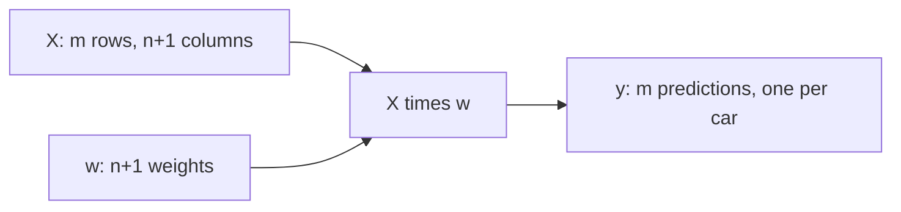

### Python: three cars

```python
import numpy as np

x1  = [1, 148, 24, 1385]
x2  = [1, 132, 25, 2031]
x10 = [1, 453, 11, 86]

X = [x1, x2, x10]
X = np.array(X)
X
```

Output:

```
array([[   1,  148,   24, 1385],
       [   1,  132,   25, 2031],
       [   1,  453,   11,   86]])
```

The weights are the same `w_new` as before:

```python
w0 = 7.17
w = [0.01, 0.04, 0.002]
w_new = [w0] + w
```

NumPy arrays have a `dot` method that does the whole multiplication in one line:

```python
def linear_regression(X):
    return X.dot(w_new)

linear_regression(X)
```

Output:

```
array([12.38 , 13.552, 12.312])
```

The third value is car number 10, the same 12.312 we got before. Each number is a **log price**, so convert to dollars with `np.expm1` when needed:

```python
np.expm1(linear_regression(X))
```

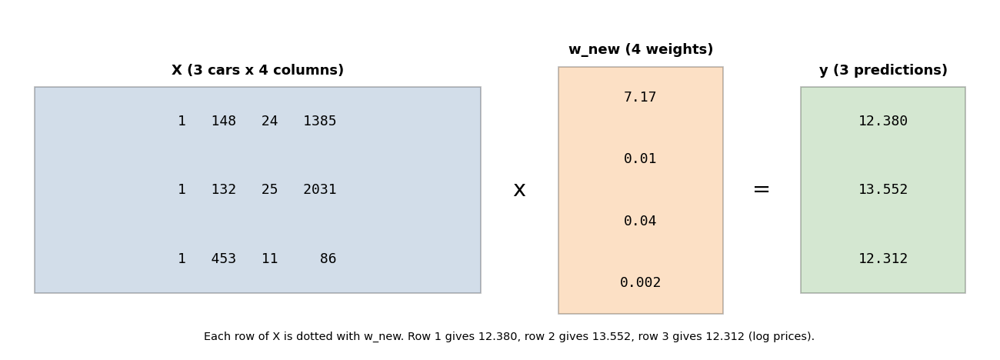

---

## 6. Shapes check

A quick way to avoid bugs is to check shapes:

```python
X.shape       # (3, 4): 3 cars, 4 columns (1 bias column + 3 features)
w_new         # 4 weights
X.dot(w_new)  # 3 predictions
```

Rule: the number of **columns** in `X` must equal the number of **weights**. The result has one value per **row**.

---

## 7. Full code of the lesson

```python
import numpy as np

w0 = 7.17
w = [0.01, 0.04, 0.002]
w_new = [w0] + w

# One car, using the dot product by hand
def dot(xi, w):
    n = len(xi)
    res = 0.0
    for j in range(n):
        res = res + xi[j] * w[j]
    return res

def linear_regression_one(xi):
    xi = [1] + xi
    return dot(xi, w_new)

print(linear_regression_one([453, 11, 86]))   # 12.312

# Many cars at once, using a matrix
X = np.array([
    [1, 148, 24, 1385],
    [1, 132, 25, 2031],
    [1, 453, 11, 86],
])

def linear_regression(X):
    return X.dot(w_new)

y_log = linear_regression(X)      # [12.38, 13.552, 12.312]
y_price = np.expm1(y_log)         # prices in dollars
print(y_log, y_price)
```

---

## 8. Cheat sheet

| Idea | Math | Code |
|------|------|------|
| One car, sum form | w0 + sum(xij * wj) | loop over features |
| One car, dot product | w0 + dot(xi, w) | `w0 + dot(xi, w)` |
| Fictional feature | xi0 = 1 | `[1] + xi` and `[w0] + w` |
| All cars | X times w | `X.dot(w_new)` |
| Back to dollars | inverse of log1p | `np.expm1(...)` |

---

## 9. Key takeaways

- The sum over features in linear regression is a **dot product**.
- Adding a **fictional feature equal to 1** lets the bias join the dot product, so the whole model is just `xi . w`.
- For the full dataset, linear regression is a **matrix-vector multiplication**: `X . w` gives one prediction per row.
- Vectorized NumPy code is shorter and much faster than Python loops.
- The model still predicts **log price**, so use `np.expm1` to get dollars.
- We still invented the weights. The next lesson shows how to compute them from data.

---

## 10. Navigation

- Previous: 2.5 Linear regression (simple version)
- Next: 2.7 Training a linear regression model

# # 2.7 Training Linear Regression: Normal Equation

**Chapter 2: Machine Learning for Regression**

- Lesson video: https://www.youtube.com/watch?v=hx6nak-Y11g&list=PL3MmuxUbc_hIhxl5Ji8t4O6lPAOpHaCLR&index=18
- Course notes: https://github.com/DataTalksClub/machine-learning-zoomcamp/blob/main/02-regression/07-linear-regression-training.md

> Formula tip: every formula is written as LaTeX (`$$` block) and again in plain text with Unicode symbols (Xᵀ for the transpose, X⁻¹ for the inverse). If your editor does not render math, the plain-text line still reads correctly.

---

## 1. Goal of this lesson

In 2.6 we applied a linear regression model **when the weights were already given**. Now we answer the missing question: **where do the weights come from?**

We derive a closed-form formula, the **normal equation**, and implement it as a function `train_linear_regression(X, y)`.

### Diagram: lesson workflow

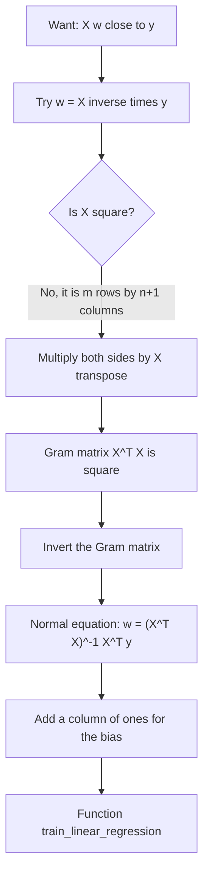

---

## 2. Symbols used in this lesson

| Symbol | Name | Meaning |
|--------|------|---------|
| X | Feature matrix | One row per car, one column per feature |
| y | Target vector | The prices we want to predict |
| w | Weight vector | The unknowns we are solving for |
| Xᵀ | Transpose of X | X flipped: rows become columns and columns become rows |
| X⁻¹ | Inverse of X | The matrix that undoes X, so that X⁻¹X = I (only for square matrices) |
| I | Identity matrix | Ones on the diagonal, zeros elsewhere. Multiplying by I changes nothing |
| XᵀX | Gram matrix | Transpose of X times X. Always square |
| (XᵀX)⁻¹ | Inverse of the Gram matrix | Used to isolate w |

---

## 3. Terms explained

**Closed-form solution**
A formula that gives the answer directly, with no repeated guessing or iterations.

**Square matrix**
A matrix with the same number of rows and columns. Only square matrices can have an inverse.

**Rectangular matrix**
A matrix whose rows and columns differ in number. Our X is rectangular: `m` cars (thousands of rows) and `n+1` columns (features plus the bias column).

**Identity matrix (I)**
The matrix version of the number 1. For any matrix A, `I · A = A`.

**Inverse matrix**
For a square matrix A, the matrix A⁻¹ with `A⁻¹ · A = I`. It is the matrix version of dividing.

**Transpose (Xᵀ)**
Flip a matrix over its diagonal. A matrix with m rows and n+1 columns becomes n+1 rows and m columns. In NumPy: `X.T`.

**Gram matrix**
The product XᵀX. If X has shape (m, n+1), then XᵀX has shape (n+1, n+1), which is square.

**Normal equation**
The formula `w = (XᵀX)⁻¹ Xᵀ y` that gives the best weights for linear regression.

**Floating-point error**
Computers store decimals with limited precision, so results such as 0.0000000001 appear where the exact answer is 0.

---

## 4. Solving for the weights

We want our predictions to be close to the actual targets:

$$
Xw \approx y
$$

Plain text:

```
X w ≈ y
```

### The ideal case

If X had an inverse, we could multiply both sides by X⁻¹. Since X⁻¹X = I and I w = w:

$$
X^{-1} X w = X^{-1} y \quad\Rightarrow\quad w = X^{-1} y
$$

Plain text:

```
X⁻¹ X w = X⁻¹ y   →   I w = X⁻¹ y   →   w = X⁻¹ y
```

### The problem

X is **rectangular**: m rows (cars) and n+1 columns. Only square matrices have an inverse, so this exact solution does not exist.

---

## 5. The Gram matrix and the normal equation

We cannot solve the system exactly, but we can find the **closest possible** solution. Multiply both sides of `Xw ≈ y` by the transpose of X:

$$
X^T X w = X^T y
$$

Plain text:

```
Xᵀ X w = Xᵀ y
```

The matrix XᵀX is the **Gram matrix**. It is square, with n+1 rows and n+1 columns, so (usually) it has an inverse. Multiply both sides by that inverse:

$$
(X^T X)^{-1} X^T X w = (X^T X)^{-1} X^T y
$$

The left side simplifies, because `(XᵀX)⁻¹ XᵀX = I` and `I w = w`. This leaves the **normal equation**:

$$
w = (X^T X)^{-1} X^T y
$$

Plain text:

```
w = (XᵀX)⁻¹ Xᵀ y
```

### Diagram: shapes along the way

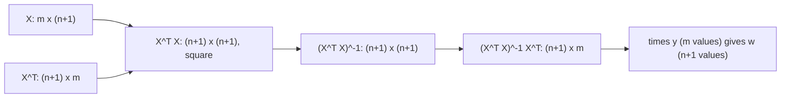

Notes:

- This `w` is **not** the solution of the original system (that does not exist). It is the closest possible one. The formal proof needs more math, and the book "Elements of Statistical Learning" covers it.
- "Usually has an inverse" matters. In some cases the Gram matrix has no inverse. Lesson 2.13 (regularization) deals with that.

---

## 6. Implementing it in NumPy

We start with a small toy matrix: 9 cars and 3 features.

```python
import numpy as np

X = [
    [148, 24, 1385],
    [132, 25, 2031],
    [453, 11, 86],
    [158, 24, 185],
    [172, 25, 201],
    [413, 11, 86],
    [38, 54, 185],
    [142, 25, 431],
    [453, 31, 86],
]
X = np.array(X)
```

### Step 1: the Gram matrix

```python
XTX = X.T.dot(X)
```

### Step 2: its inverse

```python
XTX_inv = np.linalg.inv(XTX)
```

### Step 3: sanity check

The Gram matrix times its inverse should be the identity matrix:

```python
XTX.dot(XTX_inv).round(1)
```

Output:

```
array([[ 1., -0.,  0.],
       [-0.,  1.,  0.],
       [ 0.,  0.,  1.]])
```

Ones on the diagonal and values close to zero elsewhere. The `-0.` are floating-point round-off, and we treat them as zero.

### Step 4: a made-up target

```python
y = [100, 200, 150, 250, 100, 200, 150, 250, 120]
```

### Step 5: the weights

```python
w_full = XTX_inv.dot(X.T).dot(y)
```

---

## 7. Adding the bias term

The toy matrix forgot the **bias** (`w0`), the baseline prediction when we know nothing about the car. To include it, we add a column of ones as the first column of X and repeat the steps:

```python
ones = np.ones(X.shape[0])
X = np.column_stack([ones, X])

XTX = X.T.dot(X)
XTX_inv = np.linalg.inv(XTX)
w_full = XTX_inv.dot(X.T).dot(y)
```

`np.column_stack` places the vector of ones next to the feature columns, so the ones become the first column.

Split the result into the bias and the feature weights:

```python
w0 = w_full[0]
w = w_full[1:]
```

On this toy data we get (rounded):

```
w0 = 300.068
w  = [-0.2277, -2.5769, -0.023]
```

The weights are negative here. A **negative weight** means the prediction goes **down** as the feature grows (like the age of a car: older means cheaper). Earlier examples had positive weights, where more horsepower meant a higher price.

---

## 8. The training function

We wrap everything into one function. It adds the column of ones itself, so the caller passes only the plain feature matrix:

```python
def train_linear_regression(X, y):
    ones = np.ones(X.shape[0])
    X = np.column_stack([ones, X])

    XTX = X.T.dot(X)
    XTX_inv = np.linalg.inv(XTX)
    w_full = XTX_inv.dot(X.T).dot(y)

    return w_full[0], w_full[1:]
```

Usage:

```python
w0, w = train_linear_regression(X, y)
```

It returns the bias `w0` and the weights `w` separately. In the next lesson we use it on the car price data.

### Optional: a numerically safer version

Explicitly inverting a matrix is fine for learning, but `np.linalg.solve` solves the same equation more stably and is a little faster. It solves `(XᵀX) w = Xᵀy` without building the inverse:

```python
def train_linear_regression_solve(X, y):
    ones = np.ones(X.shape[0])
    X = np.column_stack([ones, X])

    XTX = X.T.dot(X)
    w_full = np.linalg.solve(XTX, X.T.dot(y))

    return w_full[0], w_full[1:]
```

The lessons keep `inv` because it mirrors the formula. Both give the same weights when the Gram matrix is well-behaved.

---

## 9. Cheat sheet

| Math | NumPy |
|------|-------|
| Xᵀ | `X.T` |
| XᵀX | `X.T.dot(X)` |
| (XᵀX)⁻¹ | `np.linalg.inv(XTX)` |
| (XᵀX)⁻¹ Xᵀ y | `XTX_inv.dot(X.T).dot(y)` |
| Add the bias column | `np.column_stack([np.ones(X.shape[0]), X])` |
| Column of ones | `np.ones(n)` |

---

## 10. Key takeaways

- The weights come from the **normal equation**: `w = (XᵀX)⁻¹ Xᵀ y`.
- X is rectangular, so it has no inverse. The **Gram matrix** XᵀX is square, so we can invert that instead.
- The result is the **closest possible** solution, not an exact one.
- Add a **column of ones** to X so the bias term `w0` is learned like any other weight.
- `train_linear_regression(X, y)` hides the bias column and returns `(w0, w)`.
- A negative weight means the prediction decreases when that feature increases.
- Sometimes XᵀX has no inverse. Regularization (2.13) is the fix.

---

## 11. Navigation

- Previous: 2.6 Linear regression: vector form
- Next: 2.8 Baseline model for car price prediction project

# # 2.8 Baseline Model for Car Price Prediction Project

**Chapter 2: Machine Learning for Regression**

- Lesson video: https://www.youtube.com/watch?v=SvPpMMYtYbU&list=PL3MmuxUbc_hIhxl5Ji8t4O6lPAOpHaCLR&index=19
- Course notes: https://github.com/DataTalksClub/machine-learning-zoomcamp/blob/main/02-regression/08-baseline-model.md
- Notebook: https://github.com/alexeygrigorev/mlbookcamp-code/blob/master/chapter-02-car-price/02-carprice.ipynb

---

## 1. Goal of this lesson

We finally use `train_linear_regression` from 2.7 on the real car price data. The first model is deliberately simple: **numerical features only**. It becomes the **baseline**, the reference point that every later improvement has to beat.

### Diagram: lesson workflow

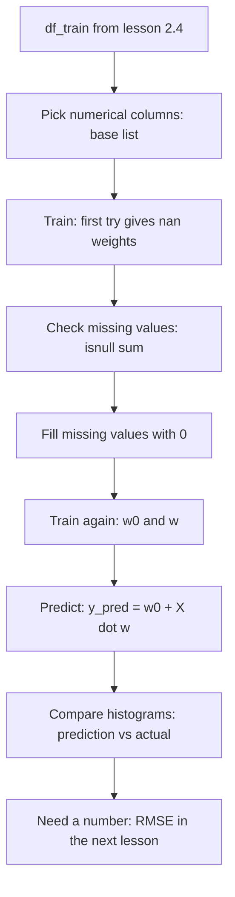

---

## 2. Terms explained

**Baseline model**
A simple first model that sets the minimum level of quality. Later models are compared against it, so we can tell whether a change really improved things.

**Numerical feature**
A column with numbers (horsepower, mpg). Our linear regression only works with numbers. Text columns need a conversion first (lesson 2.12).

**NaN (not a number)**
What a computation returns when it cannot produce a real value. One missing value in the data can turn all the weights into NaN.

**Imputation (filling missing values)**
Replacing missing values with a chosen number, such as 0 or the mean of the column.

**Log scale**
Our target is `log1p(msrp)`, so predictions are also **log prices**. We convert back with `np.expm1` when we need dollars.

**Overlapping histograms**
Two histograms in one plot, made semi-transparent (`alpha`) so both are visible. A quick visual comparison of two distributions.

---

## 3. Selecting the base features

Check the available columns first:

```python
df_train.columns
```

Linear regression, as we implemented it, takes only numbers. So the baseline uses the numerical columns:

- `engine_hp`: engine horsepower
- `engine_cylinders`: number of cylinders
- `highway_mpg`: miles per gallon on the highway
- `city_mpg`: miles per gallon in the city
- `popularity`: number of mentions

```python
base = ['engine_hp', 'engine_cylinders', 'highway_mpg',
        'city_mpg', 'popularity']
```

Select these columns and take the values as a NumPy array:

```python
X_train = df_train[base].values
```

---

## 4. Dealing with missing values

Try to train right away:

```python
w0, w = train_linear_regression(X_train, y_train)
```

The result is not what we expect: the bias and all weights are `nan`.

Something is wrong with the data. Look for missing values:

```python
df_train[base].isnull().sum()
```

`engine_hp` and `engine_cylinders` have missing values. The simplest fix is filling them with zeros:

```python
X_train = df_train[base].fillna(0).values
```

### Why zero works (even though it looks wrong)

No car has 0 horsepower or 0 cylinders, so zero looks strange. But look at what a missing value does in the formula. Say the first feature is missing for a car:

$$
g(x_i) = w_0 + x_{i1} w_1 + x_{i2} w_2 \quad\text{with}\quad x_{i1} = 0 \;\Rightarrow\; g(x_i) = w_0 + x_{i2} w_2
$$

Plain text:

```
g(xi) = w0 + xi1*w1 + xi2*w2
with xi1 = 0:   g(xi) = w0 + xi2*w2
```

The term `xi1 * w1` disappears, so the model **ignores** that feature for that car. This keeps things simple, and for a baseline it is good enough.

A more sensible choice is often the **mean** of the column, computed on the training set only. A zero is simply the easiest option, and it sometimes works well.

---

## 5. Training the model

```python
X_train = df_train[base].fillna(0).values
w0, w = train_linear_regression(X_train, y_train)
```

On the course data the bias comes out around `w0 ≈ 7.93`. It is on the **log scale**, because we predict the log of the price. Together with the five weights, this is our baseline model.

---

## 6. Predictions vs actual prices

Apply the model to the training data with a matrix-vector product, adding the bias separately:

```python
y_pred = w0 + X_train.dot(w)
```

Plot the predictions and the real targets in one chart:

```python
import seaborn as sns

sns.histplot(y_pred, color='red', alpha=0.5, bins=50)
sns.histplot(y_train, color='blue', alpha=0.5, bins=50)
```

The `alpha` parameter sets transparency, so both histograms are visible.

What to look for: in the course the red histogram (predictions) sits to the **left** of the blue one (actual). In many cases the model predicts a price lower than the real price. So the model is clearly not perfect.

### Diagram: what the picture tells us

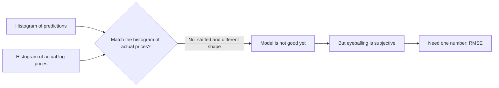

Looking at a chart is not an objective way to compare models. When we improve the model, we want proof that it really got better. We need a single number that measures quality, and that is RMSE (next lesson).

---

## 7. Full code of the lesson

```python
base = ['engine_hp', 'engine_cylinders', 'highway_mpg',
        'city_mpg', 'popularity']

# check missing values
df_train[base].isnull().sum()

# features: numerical columns, missing values filled with 0
X_train = df_train[base].fillna(0).values

# train
w0, w = train_linear_regression(X_train, y_train)

# predict (log prices)
y_pred = w0 + X_train.dot(w)

# compare distributions
sns.histplot(y_pred, color='red', alpha=0.5, bins=50)
sns.histplot(y_train, color='blue', alpha=0.5, bins=50)
```

---

## 8. Cheat sheet

| Code | What it does |
|------|--------------|
| `df[cols].values` | Selected columns as a NumPy array |
| `df[cols].isnull().sum()` | Missing values per column |
| `df[cols].fillna(0)` | Replace missing values with 0 |
| `w0 + X.dot(w)` | Predictions for all rows |
| `sns.histplot(..., alpha=0.5)` | Semi-transparent histogram for overlaying |

---

## 9. Key takeaways

- A **baseline** is a simple first model, and later models must beat it.
- Our baseline uses only the five **numerical** features.
- One missing value can make all weights **NaN**, so always check `isnull().sum()` before training.
- Filling with **0** makes a feature drop out of the formula for that car. The **mean** is often more sensible, but 0 is simple.
- Predictions are in **log scale**, because we trained on `log1p(msrp)`.
- Comparing histograms shows the model is off, but we need a number to measure it: **RMSE**.

---

## 10. Navigation

- Previous: 2.7 Training linear regression: normal equation
- Next: 2.9 Root mean squared error (RMSE)

# # 2.9 Root Mean Squared Error (RMSE)

**Chapter 2: Machine Learning for Regression**

- Lesson video: https://www.youtube.com/watch?v=0LWoFtbzNUM&list=PL3MmuxUbc_hIhxl5Ji8t4O6lPAOpHaCLR&index=20
- Slides: https://www.slideshare.net/AlexeyGrigorev/ml-zoomcamp-2-slides
- Course notes: https://github.com/DataTalksClub/machine-learning-zoomcamp/blob/main/02-regression/09-rmse.md

> Formula tip: the RMSE formula is written as LaTeX and again in plain text underneath.

---

## 1. Goal of this lesson

In 2.8 we saw that predictions were a bit off, but only by looking at a chart. We need **one number** that tells us how good or bad a model is. That number is **RMSE**. With it we can compare models and pick the best one.

### Diagram: from errors to one number

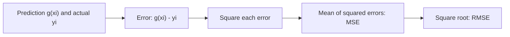

---

## 2. Terms explained

**Error (residual)**
The difference between the prediction and the actual value: `g(xi) - yi`. Positive means we predicted too high, negative too low.

**Squared error**
The error multiplied by itself. It removes the sign, so over- and under-predictions do not cancel out, and it punishes big mistakes much more than small ones.

**MSE (Mean Squared Error)**
The average of the squared errors.

**RMSE (Root Mean Squared Error)**
The square root of MSE. It brings the error back to the **same units** as the target, so it is easier to interpret.

**Observation (m)**
One row of data, here one car. `m` is the number of rows we evaluate on.

**Metric**
A number used to judge a model. For regression models, RMSE is a common choice. Lower is better.

---

## 3. The formula

$$
RMSE = \sqrt{\frac{1}{m} \sum_{i=1}^{m} \left(g(x_i) - y_i\right)^2}
$$

Plain text:

```
RMSE = sqrt( (1/m) * sum over i=1..m of ( g(xi) - yi )² )
```

Where:

- `g(xi)` is the prediction for car i
- `yi` is the actual value for car i
- `m` is the number of observations (cars)

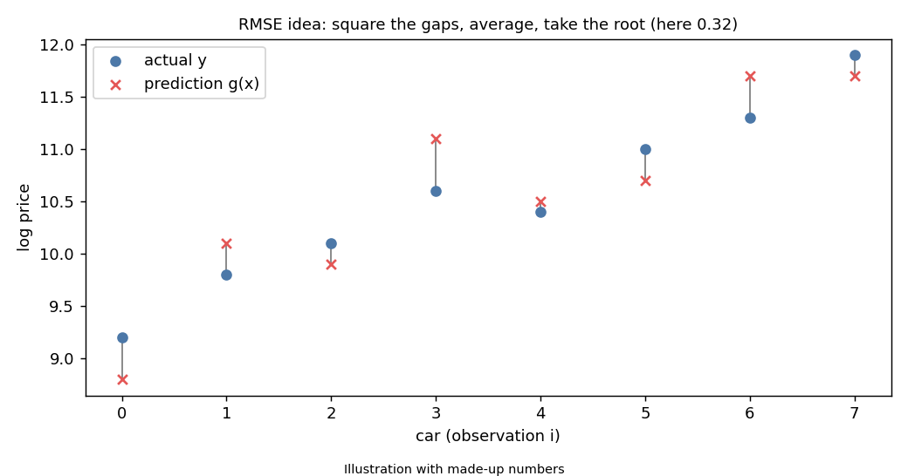

The picture is an illustration with made-up numbers: the gray lines are the errors that get squared and averaged.

---

## 4. A worked example

Three cars, with actual and predicted values:

| Car | Actual y | Prediction | Error | Squared error |
|-----|----------|------------|-------|---------------|
| 1 | 10 | 9 | -1 | 1 |
| 2 | 12 | 14 | 2 | 4 |
| 3 | 11 | 11 | 0 | 0 |

- Sum of squared errors: 1 + 4 + 0 = 5
- Mean (MSE): 5 / 3 = 1.667
- Root (RMSE): sqrt(1.667) = 1.29

---

## 5. Implementation step by step

The function takes the real values `y` and the predictions `y_pred`.

```python
import numpy as np

def rmse(y, y_pred):
    error = y_pred - y
    mse = (error ** 2).mean()
    return np.sqrt(mse)
```

Each line matches the formula:

1. `error = y_pred - y`: the differences, computed for all cars at once (NumPy works element by element)
2. `error ** 2`: squares each difference
3. `.mean()`: sums and divides by `m`
4. `np.sqrt(...)`: the square root

Check it with the worked example:

```python
y = np.array([10, 12, 11])
y_pred = np.array([9, 14, 11])

rmse(y, y_pred)
```

Output:

```
1.2909944487358056
```

Apply it to the baseline model from 2.8, on the training data:

```python
rmse(y_train, y_pred)
```

The lower the number, the better the model.

---

## 6. How to read an RMSE

- Our target is the **log** of the price, so this RMSE is in **log units**, not dollars. A value like 0.5 means predictions are typically about 0.5 off on the log scale.
- Compare RMSE values of models **trained on the same target and evaluated on the same data**. A smaller value means a better fit.
- Squaring makes RMSE sensitive to a few large errors. One very bad prediction can raise it noticeably.
- RMSE on **training** data tells how well the model fits what it has already seen. The real test is the **validation** data, next lesson.

---

## 7. Cheat sheet

| Idea | Code |
|------|------|
| Errors | `error = y_pred - y` |
| Squared errors | `error ** 2` |
| MSE | `(error ** 2).mean()` |
| RMSE | `np.sqrt(mse)` |

---

## 8. Key takeaways

- We need a single **number** to judge a model, because eyeballing histograms is not objective.
- **RMSE** = square root of the mean of the squared errors.
- Squaring removes signs and punishes large errors more.
- The square root puts the error back in the units of the target (here: log price).
- **Lower RMSE is better.**
- Always compare models using the same data and the same target.

---

## 9. Navigation

- Previous: 2.8 Baseline model for car price prediction project
- Next: 2.10 Using RMSE on validation data

# # 2.10 Using RMSE on Validation Data

**Chapter 2: Machine Learning for Regression**

- Course folder: https://github.com/DataTalksClub/machine-learning-zoomcamp/tree/main/02-regression
- Notebook: https://github.com/alexeygrigorev/mlbookcamp-code/blob/master/chapter-02-car-price/02-carprice.ipynb

---

## 1. Goal of this lesson

So far we have judged the model on the **training** data, the same data it learned from. That says little about how it behaves on new cars. In this lesson we compute **RMSE on the validation set**, which gives an honest number for how well the model works on data it has not seen.

This is also the moment where the validation framework from 2.4 pays off: we finally use `df_val` and `y_val`.

### Diagram: train on one part, measure on another

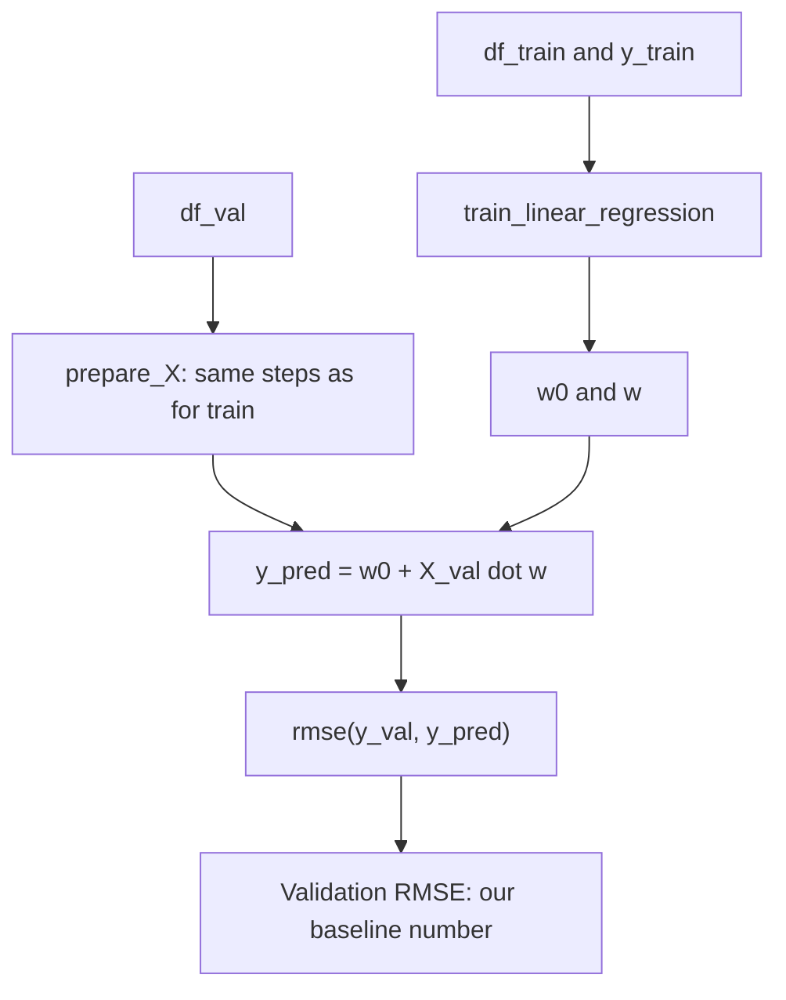

---

## 2. Terms explained

**Validation RMSE**
RMSE computed on the validation set. It estimates how well the model generalizes to new data. This is the number we use to compare models.

**Training RMSE**
RMSE on the data the model was fitted to. It is usually a bit better than the validation RMSE and can hide overfitting.

**Generalization**
How well a model performs on data it has not seen.

**Preprocessing function (`prepare_X`)**
One function that turns a DataFrame into a feature matrix. We use the **same function** for train, validation and test, so every part is treated identically.

**Data leakage**
Letting information from validation or test data influence training. Using the same preparation function with values learned from training only avoids it.

---

## 3. Put the preparation in a function

Until now we prepared the training features inline. We will need the same steps for validation (and later for test), so we wrap them in a function:

```python
base = ['engine_hp', 'engine_cylinders', 'highway_mpg',
        'city_mpg', 'popularity']

def prepare_X(df):
    df_num = df[base]
    df_num = df_num.fillna(0)
    X = df_num.values
    return X
```

Why a function: when we add new features later (age, categories), we change it in **one place**, and train, validation and test stay consistent.

---

## 4. Train, predict on validation, compute RMSE

```python
X_train = prepare_X(df_train)
w0, w = train_linear_regression(X_train, y_train)

X_val = prepare_X(df_val)
y_pred = w0 + X_val.dot(w)

rmse(y_val, y_pred)
```

Step by step:

1. `prepare_X(df_train)` builds the training features, and training gives `w0` and `w`
2. `prepare_X(df_val)` builds the validation features **with the same steps**
3. `w0 + X_val.dot(w)` predicts (log prices) for the validation cars
4. `rmse(y_val, y_pred)` compares predictions to the real validation targets

The number we get is the **baseline validation RMSE**. Every improvement from here on is measured against it.

---

## 5. Compare train and validation

It helps to print both:

```python
y_pred_train = w0 + X_train.dot(w)
y_pred_val = w0 + X_val.dot(w)

print('train:', rmse(y_train, y_pred_train))
print('val:  ', rmse(y_val, y_pred_val))
```

How to read it:

| Situation | Meaning |
|-----------|---------|
| Train and validation RMSE are close | The model generalizes, with no sign of overfitting |
| Validation much worse than train | The model memorizes noise (overfitting) |
| Both are high | The model is too simple or the features are weak (underfitting) |

---

## 6. Results log (fill in as you go)

Keep a table of each model's validation RMSE. It shows what each lesson changes.

| Model | Validation RMSE |
|-------|-----------------|
| Baseline (5 numerical features, fill 0) | |
| + age (2.11) | |
| + number of doors and categorical features (2.12) | |
| + regularization (2.13) | |
| Tuned `r` (2.14) | |

---

## 7. Full code of the lesson

```python
base = ['engine_hp', 'engine_cylinders', 'highway_mpg',
        'city_mpg', 'popularity']

def prepare_X(df):
    df_num = df[base]
    df_num = df_num.fillna(0)
    X = df_num.values
    return X

X_train = prepare_X(df_train)
w0, w = train_linear_regression(X_train, y_train)

X_val = prepare_X(df_val)
y_pred = w0 + X_val.dot(w)

print('validation RMSE:', rmse(y_val, y_pred))
```

---

## 8. Key takeaways

- Judge models on the **validation** set, not on the training set.
- Put feature preparation in a function (`prepare_X`) and use it for **every** data part.
- The validation RMSE of the baseline is our reference. Later changes must lower it.
- Comparing train and validation RMSE reveals overfitting.
- The test set stays untouched until the very end.

---

## 9. Navigation

- Previous: 2.9 Root mean squared error (RMSE)
- Next: 2.11 Feature engineering

# # 2.11 Feature Engineering

**Chapter 2: Machine Learning for Regression**

- Course folder: https://github.com/DataTalksClub/machine-learning-zoomcamp/tree/main/02-regression
- Notebook: https://github.com/alexeygrigorev/mlbookcamp-code/blob/master/chapter-02-car-price/02-carprice.ipynb

---

## 1. Goal of this lesson

The baseline ignored the `year` column. A model cannot easily use a raw year such as 2013, but it can use the **age** of the car, which clearly matters for price. In this lesson we create the new feature `age` and see how the validation RMSE improves.

This is **feature engineering**: creating new, more informative features from the ones we already have.

### Diagram: lesson workflow

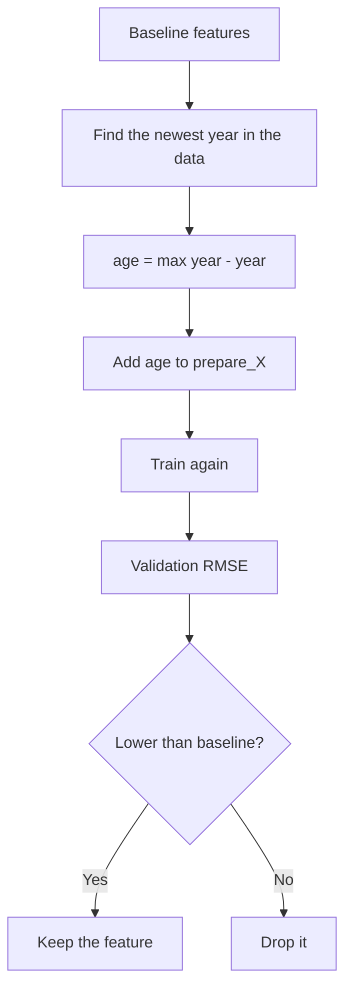

---

## 2. Terms explained

**Feature engineering**
Building new input columns from existing data so the model can learn from them more easily.

**Derived feature**
A feature computed from other columns, such as `age = 2017 - year`.

**Reference year**
The year we measure age from. The newest car in the dataset is from 2017, so 2017 is a natural choice.

**Model improvement check**
After every change, retrain and compare the validation RMSE with the previous best. If it does not drop, the change did not help.

**Side effects on the DataFrame**
Adding a column to `df` inside a function would change the caller's DataFrame as well. We avoid that with `df.copy()`.

---

## 3. Why age instead of year

- Price depends on how **old** a car is: newer cars are worth more.
- A raw year such as 1995 or 2015 is just a big number, and the model sees no direct meaning in it.
- `age = 2017 - year` turns it into a direct signal: **0** is brand new and **22** is old.

Find the newest year in the training data:

```python
df_train.year.max()
```

In this dataset it is 2017, so:

$$
age = 2017 - year
$$

Plain text:

```
age = 2017 - year
```

---

## 4. Adding age to prepare_X

We extend the function from 2.10. We copy the DataFrame first, so the original is not modified, and we add `age` to the list of features:

```python
def prepare_X(df):
    df = df.copy()
    features = base.copy()

    df['age'] = 2017 - df.year
    features.append('age')

    df_num = df[features]
    df_num = df_num.fillna(0)
    X = df_num.values
    return X
```

Details:

- `df.copy()` protects the caller's DataFrame from being changed.
- `base.copy()` does the same for the `base` list. Without it, each call would append `'age'` to the original list again and again.

---

## 5. Train and evaluate

```python
X_train = prepare_X(df_train)
w0, w = train_linear_regression(X_train, y_train)

X_val = prepare_X(df_val)
y_pred = w0 + X_val.dot(w)

rmse(y_val, y_pred)
```

On the course data the validation RMSE drops sharply compared with the baseline. Your exact value depends on your split, so compare it with **your own** baseline from 2.10.

### Plot predictions against actual values

```python
sns.histplot(y_pred, label='prediction', color='red', alpha=0.5, bins=50)
sns.histplot(y_val, label='target', color='blue', alpha=0.5, bins=50)
plt.legend()
```

The two histograms now overlap much more than for the baseline. The numbers and the picture agree: the model got better.

---

## 6. Update the results log

| Model | Validation RMSE |
|-------|-----------------|
| Baseline | (from 2.10) |
| + age | (this lesson, should be lower) |

---

## 7. Full code of the lesson

```python
def prepare_X(df):
    df = df.copy()
    features = base.copy()

    df['age'] = 2017 - df.year
    features.append('age')

    df_num = df[features]
    df_num = df_num.fillna(0)
    X = df_num.values
    return X

X_train = prepare_X(df_train)
w0, w = train_linear_regression(X_train, y_train)

X_val = prepare_X(df_val)
y_pred = w0 + X_val.dot(w)

print('validation RMSE:', rmse(y_val, y_pred))
```

---

## 8. Key takeaways

- **Feature engineering** creates better inputs from existing columns.
- `age = 2017 - year` is easier for a linear model to use than the raw year.
- Copy the DataFrame and the feature list inside `prepare_X` to avoid hidden side effects.
- After each new feature, retrain and compare the **validation RMSE**. Keep only changes that lower it.
- Choosing good features often improves a model more than choosing a fancier algorithm.

---

## 9. Navigation

- Previous: 2.10 Using RMSE on validation data
- Next: 2.12 Categorical variables

# # 2.12 Categorical Variables

**Chapter 2: Machine Learning for Regression**

- Course folder: https://github.com/DataTalksClub/machine-learning-zoomcamp/tree/main/02-regression
- Notebook: https://github.com/alexeygrigorev/mlbookcamp-code/blob/master/chapter-02-car-price/02-carprice.ipynb

---

## 1. Goal of this lesson

Our model only understands numbers, but many useful columns are text: `make`, `transmission_type`, `vehicle_style`. In this lesson we convert them into numbers using **one-hot encoding**, add them to the model, and see what happens.

### Diagram: lesson workflow

```mermaid
flowchart TD
    A["Text columns: make, fuel type, ..."] --> B["One-hot encoding: one 0/1 column per value"]
    B --> C["Start with number_of_doors: 2, 3, 4"]
    C --> D["Extend to make: top 5 values only"]
    D --> E["Extend to all categorical columns"]
    E --> F["Validation RMSE"]
    F --> G["Surprise: RMSE can explode"]
    G --> H["Next lesson: regularization"]
```

---

## 2. Terms explained

**Categorical variable**
A column whose values are categories (labels), such as `toyota` or `automatic`. It has no numeric meaning.

**Numerical variable**
A column whose values are real numbers that can be added and compared.

**One-hot encoding**
Replace one categorical column with several binary (0 or 1) columns, one per category value. Exactly one of them is 1 for each row ("hot").

**Binary feature**
A feature that is only 0 or 1. Here, 1 means "this car has this category value".

**`number_of_doors`**
Numeric in the data (2, 3, 4), but really a category: 4 doors is not "twice" 2 doors in price. We encode it as categorical.

**Top-N categories**
When a column has many values (dozens of makes), we encode only the N most frequent ones. Everything else gets 0 in all columns.

**Multicollinearity (collinear features)**
When features are almost copies or combinations of each other. This can make the Gram matrix nearly singular and the weights unstable. More in 2.13.

---

## 3. How one-hot encoding works

Take a column with three values:

| Car | number_of_doors |
|-----|-----------------|
| A | 2 |
| B | 4 |
| C | 3 |

One-hot encoding turns it into three binary columns:

| Car | num_doors_2 | num_doors_3 | num_doors_4 |
|-----|-------------|-------------|-------------|
| A | 1 | 0 | 0 |
| B | 0 | 0 | 1 |
| C | 0 | 1 | 0 |

The model gets a separate weight for each column. For a 4-door car, only `num_doors_4` contributes, so each category gets its own price effect.

### Diagram: one column becomes several

```mermaid
flowchart LR
    A["number_of_doors = 4"] --> B["num_doors_2 = 0"]
    A --> C["num_doors_3 = 0"]
    A --> D["num_doors_4 = 1"]
```

---

## 4. Step 1: number of doors

```python
for v in [2, 3, 4]:
    df_train['num_doors_%s' % v] = (df_train.number_of_doors == v).astype(int)
```

How it works:

- `df_train.number_of_doors == v` gives True/False for each row
- `.astype(int)` converts True/False to 1/0
- `'num_doors_%s' % v` builds the column name, e.g. `num_doors_4`

Inside `prepare_X` we collect the new names in the feature list:

```python
def prepare_X(df):
    df = df.copy()
    features = base.copy()

    df['age'] = 2017 - df.year
    features.append('age')

    for v in [2, 3, 4]:
        feature = 'num_doors_%s' % v
        df[feature] = (df['number_of_doors'] == v).astype(int)
        features.append(feature)

    df_num = df[features]
    df_num = df_num.fillna(0)
    X = df_num.values
    return X
```

Train and evaluate as before. The validation RMSE changes only a little, since the number of doors adds little information.

---

## 5. Step 2: the most popular makes

A column such as `make` has many values. Encoding all of them would create many columns, so we take the most frequent ones:

```python
df_train.make.value_counts().head(5)
```

Turn the names into a list:

```python
makes = list(df_train.make.value_counts().head().index)
makes
```

Then add one binary feature per make:

```python
for v in makes:
    feature = 'make_%s' % v
    df[feature] = (df['make'] == v).astype(int)
    features.append(feature)
```

Rare makes get zeros in all five columns, which the model treats as "other".

**Important:** the list of top values is determined on the **training** data only, and then reused unchanged for validation and test. Otherwise validation information would leak into the features.

---

## 6. Step 3: all categorical columns

We repeat the idea for the other text columns. The top values per column are stored in a dictionary, computed once on the training data:

```python
categorical_columns = [
    'make', 'engine_fuel_type', 'transmission_type',
    'driven_wheels', 'market_category', 'vehicle_size', 'vehicle_style'
]

categories = {}

for c in categorical_columns:
    categories[c] = list(df_train[c].value_counts().head(5).index)
```

Now `prepare_X` loops over that dictionary:

```python
def prepare_X(df):
    df = df.copy()
    features = base.copy()

    df['age'] = 2017 - df.year
    features.append('age')

    for v in [2, 3, 4]:
        feature = 'num_doors_%s' % v
        df[feature] = (df['number_of_doors'] == v).astype(int)
        features.append(feature)

    for c, values in categories.items():
        for v in values:
            feature = '%s_%s' % (c, v)
            df[feature] = (df[c] == v).astype(int)
            features.append(feature)

    df_num = df[features]
    df_num = df_num.fillna(0)
    X = df_num.values
    return X
```

Details:

- `categories` is built **once** from `df_train`. `prepare_X` only reads it.
- Column names look like `make_toyota` or `transmission_type_automatic`.
- At most 5 columns are created per categorical column (fewer when a column has fewer than 5 distinct values). Check the real number with `X_train.shape`.

---

## 7. The surprise: RMSE gets worse

Train and evaluate with the full feature set:

```python
X_train = prepare_X(df_train)
w0, w = train_linear_regression(X_train, y_train)

X_val = prepare_X(df_val)
y_pred = w0 + X_val.dot(w)

rmse(y_val, y_pred)
```

Instead of improving, the validation RMSE can jump to a **huge** value, far worse than the baseline. In my own test run on synthetic data with the same code it went from about 0.27 to over 100.

Why: the one-hot columns are strongly related to each other and to other features. When columns are nearly copies or combinations of one another, the Gram matrix XᵀX is almost singular. Its inverse then contains enormous numbers, so the weights become huge and unstable, and predictions on new data go wild.

### Diagram: why it breaks

```mermaid
flowchart TD
    A["Many one-hot columns"] --> B["Some columns nearly duplicate others"]
    B --> C["X^T X is almost singular"]
    C --> D["Inverse has huge values"]
    D --> E["Huge unstable weights"]
    E --> F["Large validation RMSE"]
    F --> G["Fix: regularization, lesson 2.13"]
```

---

## 8. Cheat sheet

| Code | What it does |
|------|--------------|
| `(df[c] == v).astype(int)` | Binary feature: 1 if the value equals `v`, else 0 |
| `df[c].value_counts()` | Count each category |
| `df[c].value_counts().head(5).index` | The 5 most frequent categories |
| `list(...)` | Convert the Index to a plain list |
| `'%s_%s' % (c, v)` | Build a column name |

---

## 9. Key takeaways

- Models need numbers, so text columns must be encoded. **One-hot encoding** gives one 0/1 column per category.
- `number_of_doors` is numeric in the data but behaves like a category.
- For columns with many values, encode only the **top N** most frequent ones.
- Learn the top values from the **training** data only and reuse them for validation and test.
- Adding many correlated columns can make plain linear regression **unstable**, and the RMSE can explode.
- The fix is **regularization**, the next lesson.

---

## 10. Navigation

- Previous: 2.11 Feature engineering
- Next: 2.13 Regularization

# # 2.13 Regularization

**Chapter 2: Machine Learning for Regression**

- Course folder: https://github.com/DataTalksClub/machine-learning-zoomcamp/tree/main/02-regression
- Notebook: https://github.com/alexeygrigorev/mlbookcamp-code/blob/master/chapter-02-car-price/02-carprice.ipynb

> Formula tip: formulas are written as LaTeX (`$$` block) and again in plain text with Unicode symbols (Xᵀ for the transpose, X⁻¹ for the inverse).

---

## 1. Goal of this lesson

In 2.12 the model broke: adding many correlated features made the RMSE explode. **Regularization** fixes it. We add a small number `r` to the diagonal of the Gram matrix XᵀX before inverting it. That keeps the weights small and the model stable.

### Diagram: lesson workflow

```mermaid
flowchart TD
    A["Problem: RMSE explodes in 2.12"] --> B["Cause: X^T X almost singular, huge weights"]
    B --> C["Idea: add r to the diagonal of X^T X"]
    C --> D["Matrix becomes safely invertible"]
    D --> E["Weights shrink toward 0"]
    E --> F["Function train_linear_regression_reg"]
    F --> G["Validation RMSE is normal again"]
```

---

## 2. Terms explained

**Regularization**
A technique that keeps model weights small, so the model stays stable and generalizes better.

**Singular matrix**
A matrix with no inverse. Typical cause: one column is an exact copy or exact combination of others.

**Nearly singular matrix**
A matrix that has an inverse on paper, but whose inverse contains gigantic numbers. Computations become unreliable.

**Collinear features**
Features that are (almost) copies or combinations of each other. They produce singular or nearly singular Gram matrices.

**Regularization parameter (`r`)**
How strongly we regularize. `r = 0` means no regularization. Bigger `r` shrinks the weights more.

**Ridge regression**
Linear regression with this kind of L2 regularization (adding `r` to the diagonal). It is the version taught here.

**Hyperparameter**
A setting we choose ourselves instead of learning from data. `r` is one. We pick it using the validation set (next lesson).

**Identity matrix (I)**
Ones on the diagonal and zeros elsewhere. In NumPy: `np.eye(n)`.

---

## 3. The problem: duplicate features

Consider a toy matrix where the 2nd and 3rd columns are almost identical:

```python
import numpy as np

X = [
    [4, 4, 4],
    [3, 5, 5],
    [5, 1, 1],
    [5, 4, 4],
    [7, 5, 5],
    [4, 5, 5.0001],
]
X = np.array(X)
y = [1, 2, 3, 1, 2, 3]
```

(The very last value differs by just `0.0001`. With an even smaller difference, such as `5.00000001`, NumPy may report a `Singular matrix` error instead of returning numbers. Both cases show the same problem.)

Apply the normal equation from 2.7:

```python
XTX = X.T.dot(X)
XTX_inv = np.linalg.inv(XTX)

w = XTX_inv.dot(X.T).dot(y)
w
```

Output (rounded):

```
array([ 0.4, -17449.2, 17449.1])
```

Two weights of about **-17449** and **+17449**. They almost cancel each other, since the two columns are nearly the same. The training data fits fine, but the weights are huge and the model is fragile. Any small change in new data produces a big change in the prediction. That is what happened to our car model in 2.12.

---

## 4. The fix: add r to the diagonal

Add a small number to the diagonal of the Gram matrix:

$$
X^T X + rI
$$

Plain text:

```
XᵀX + r·I
```

Then continue as before:

$$
w = (X^T X + rI)^{-1} X^T y
$$

Plain text:

```
w = (XᵀX + r·I)⁻¹ Xᵀ y
```

What `r·I` looks like for a 3 x 3 matrix with `r = 0.01`:

```
XᵀX + r·I = XᵀX + [[0.01, 0,    0   ],
                    [0,    0.01, 0   ],
                    [0,    0,    0.01]]
```

Every diagonal entry grows a little, so the columns no longer look identical to the matrix, and the inverse becomes well-behaved.

### Diagram: effect of the added diagonal

```mermaid
flowchart LR
    A["X^T X: almost singular"] -->|"add r on the diagonal"| B["X^T X + rI: safely invertible"]
    B --> C["Inverse has moderate values"]
    C --> D["Small stable weights"]
```

---

## 5. Seeing it in code

```python
XTX = X.T.dot(X)
XTX = XTX + 0.01 * np.eye(XTX.shape[0])

XTX_inv = np.linalg.inv(XTX)
w = XTX_inv.dot(X.T).dot(y)
w
```

Output (rounded):

```
array([0.3364, 0.0338, 0.0463])
```

The weights are now small and sensible. The two near-duplicate columns get similar small weights, instead of two huge canceling ones.

### Weights as `r` grows

The chart below uses this same toy example. At `r = 0` the weights are about plus and minus 17449. Already at `r = 0.000001` they drop by orders of magnitude, and they settle near each other as `r` grows.

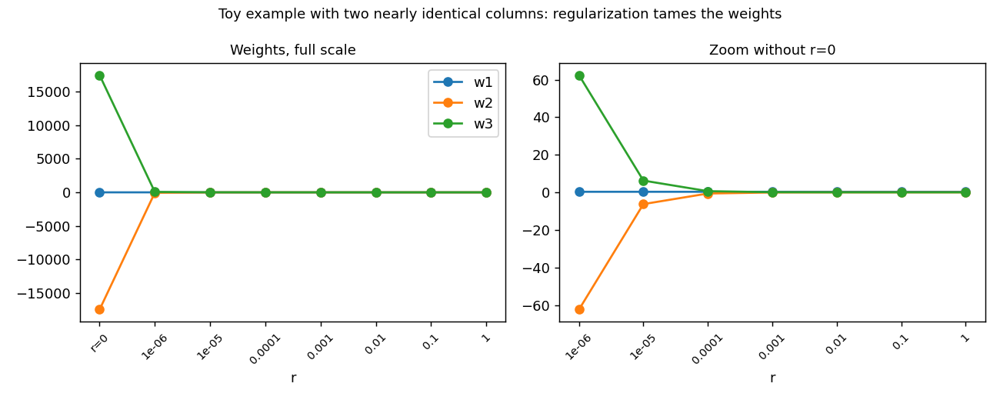

| r | w for column 2 | w for column 3 |
|---|----------------|----------------|
| 0 | -17449.2 | 17449.1 |
| 0.000001 | -62.4 | 62.5 |
| 0.00001 | -6.23 | 6.31 |
| 0.0001 | -0.59 | 0.67 |
| 0.001 | -0.02 | 0.10 |
| 0.01 | 0.03 | 0.05 |
| 0.1 | 0.04 | 0.04 |
| 1 | 0.05 | 0.05 |

---

## 6. The training function with regularization

Compared to `train_linear_regression` from 2.7, only two lines are new:

```python
def train_linear_regression_reg(X, y, r=0.0):
    ones = np.ones(X.shape[0])
    X = np.column_stack([ones, X])

    XTX = X.T.dot(X)
    reg = r * np.eye(XTX.shape[0])
    XTX = XTX + reg

    XTX_inv = np.linalg.inv(XTX)
    w_full = XTX_inv.dot(X.T).dot(y)

    return w_full[0], w_full[1:]
```

Details:

- `r` has a default of `0.0`, which gives the same weights as the plain version.
- `np.eye(XTX.shape[0])` builds the identity matrix of the right size.
- The bias column is regularized as well, because `r` is added to the whole diagonal. This is how the lesson does it.

---

## 7. Applying it to the car model

Train with a small `r` and evaluate on the validation set:

```python
X_train = prepare_X(df_train)
w0, w = train_linear_regression_reg(X_train, y_train, r=0.01)

X_val = prepare_X(df_val)
y_pred = w0 + X_val.dot(w)

rmse(y_val, y_pred)
```

The RMSE that exploded in 2.12 is back to a normal value, usually better than the numeric-only model, since the new features now carry real signal. How large `r` should be is the topic of the next lesson.

---

## 8. Two ways to think about it

- **Mathematical view:** adding `r` to the diagonal makes XᵀX safely invertible.
- **Model view:** it **punishes large weights**. The model must now balance fitting the data against keeping the weights small, so it avoids relying on huge canceling weights that fit noise.

Too much regularization is also bad. The weights are pushed so close to 0 that the model cannot learn real patterns, so we need a middle value of `r`.

---

## 9. Cheat sheet

| Math | NumPy |
|------|-------|
| Identity matrix I | `np.eye(n)` |
| XᵀX + r·I | `XTX + r * np.eye(XTX.shape[0])` |
| (XᵀX + r·I)⁻¹ | `np.linalg.inv(XTX)` after adding `r` |
| Weights | `XTX_inv.dot(X.T).dot(y)` |

---

## 10. Key takeaways

- Collinear (nearly duplicate) features make XᵀX almost singular, which produces **huge unstable weights**.
- **Regularization** adds `r` to the diagonal: `w = (XᵀX + rI)⁻¹ Xᵀ y`.
- Larger `r` means smaller weights. `r = 0` means no regularization.
- It only takes two extra lines in the training function.
- `r` is a **hyperparameter**, chosen with the validation set. That comes next.
- Too small `r` leaves instability. Too large `r` underfits.

---

## 11. Navigation

- Previous: 2.12 Categorical variables
- Next: 2.14 Tuning the model

# # 2.14 Tuning the Model

**Chapter 2: Machine Learning for Regression**

- Course folder: https://github.com/DataTalksClub/machine-learning-zoomcamp/tree/main/02-regression
- Notebook: https://github.com/alexeygrigorev/mlbookcamp-code/blob/master/chapter-02-car-price/02-carprice.ipynb

---

## 1. Goal of this lesson

Regularization needs a value for `r`. Too small and the weights stay unstable, too large and the model cannot learn. In this lesson we **tune** `r`: try several values, measure the **validation RMSE** for each, and keep the best one.

### Diagram: tuning loop

```mermaid
flowchart TD
    A["List of candidate r values"] --> B["Pick next r"]
    B --> C["Train on df_train with this r"]
    C --> D["Predict on df_val"]
    D --> E["Compute validation RMSE"]
    E --> F{"More values left?"}
    F -- Yes --> B
    F -- No --> G["Choose r with the lowest RMSE"]
```

---

## 2. Terms explained

**Hyperparameter**
A setting chosen by us before training, not learned from the data. Here: `r`.

**Parameter**
A value learned from the data. Here: the weights `w0` and `w`.

**Tuning (hyperparameter search)**
Trying different hyperparameter values and keeping the one that performs best on the validation set.

**Grid search**
Trying a fixed list of values one by one. That is what we do here.

**Log-spaced values**
Candidates that grow by factors of 10 (0.0001, 0.001, 0.01, ...). Useful because the effect of `r` changes by orders of magnitude, not by small steps.

**Underfitting**
The model is too restricted to learn real patterns. Too large `r` causes it.

**Overfitting**
The model fits noise in the training data and fails on new data. Unstable huge weights are a sign of it.

---

## 3. Trying different values of r

Prepare the features once, outside the loop:

```python
X_train = prepare_X(df_train)
X_val = prepare_X(df_val)
```

Then loop over candidate values:

```python
for r in [0.0, 0.00001, 0.0001, 0.001, 0.01, 0.1, 1, 10]:
    w0, w = train_linear_regression_reg(X_train, y_train, r=r)
    y_pred = w0 + X_val.dot(w)
    score = rmse(y_val, y_pred)

    print(r, w0, score)
```

What to look at in the output:

- With `r = 0` the weights are unstable. On the course data the RMSE is bad, and the bias `w0` is a giant number.
- With a tiny `r` such as `0.00001` the RMSE is already back to normal.
- For moderate values the RMSE is almost flat.
- With a very large `r`, such as `10`, the RMSE starts to **get worse** again: underfitting.

### Diagram: the shape you expect

```mermaid
flowchart LR
    A["r = 0: unstable, RMSE explodes"] --> B["small r: stable, RMSE drops"]
    B --> C["moderate r: flat, near the minimum"]
    C --> D["large r: weights squashed, RMSE rises"]
```

---

## 4. Choosing the best value

Several values may give almost the same RMSE. Pick the one with the lowest validation RMSE. If there is a tie, prefer the **smaller** `r`, since less regularization changes the model less.

A tidy way to keep the results:

```python
scores = {}

for r in [0.0, 0.00001, 0.0001, 0.001, 0.01, 0.1, 1, 10]:
    w0, w = train_linear_regression_reg(X_train, y_train, r=r)
    y_pred = w0 + X_val.dot(w)
    scores[r] = round(rmse(y_val, y_pred), 4)

scores
```

```python
best_score = min(scores.values())
best_r = min(r for r, s in scores.items() if s == best_score)

print(best_r, best_score)
```

In the course, a value around `r = 0.01` is a good choice, though the RMSE differences between neighboring values are small. Use whatever your own validation results show.

---

## 5. Why validation and not test

- We used the **validation** set to choose `r`. That is its purpose: comparing models and settings.
- The **test** set must stay untouched. If we also tuned on test data, it would no longer be an honest estimate of performance on new data.
- The test set is used once, at the end (next lesson).

### Diagram: who uses which data

```mermaid
flowchart LR
    TR["Train: learn w0 and w"] --> VA["Validation: choose r and features"]
    VA --> TE["Test: final check, used once"]
```

---

## 6. Update the results log

| Model | Validation RMSE |
|-------|-----------------|
| Baseline | (from 2.10) |
| + age | (2.11) |
| + categorical features, `r = 0` | (2.12, exploded) |
| + regularization, best `r` | (this lesson) |

---

## 7. Full code of the lesson

```python
X_train = prepare_X(df_train)
X_val = prepare_X(df_val)

scores = {}

for r in [0.0, 0.00001, 0.0001, 0.001, 0.01, 0.1, 1, 10]:
    w0, w = train_linear_regression_reg(X_train, y_train, r=r)
    y_pred = w0 + X_val.dot(w)
    scores[r] = round(rmse(y_val, y_pred), 4)

print(scores)

best_score = min(scores.values())
best_r = min(r for r, s in scores.items() if s == best_score)
print('best r:', best_r, 'RMSE:', best_score)
```

---

## 8. Key takeaways

- `r` is a **hyperparameter**: we choose it, the data does not.
- **Tune** it by training with several values and comparing **validation** RMSE.
- Try values on a log scale (0.0001, 0.001, 0.01, ...).
- `r = 0` can be unstable, a moderate `r` is stable, and a very large `r` underfits.
- On ties, take the **smaller** `r`.
- Never tune on the **test** set.

---

## 9. Navigation

- Previous: 2.13 Regularization
- Next: 2.15 Using the model

# # 2.15 Using the Model

**Chapter 2: Machine Learning for Regression**

- Course folder: https://github.com/DataTalksClub/machine-learning-zoomcamp/tree/main/02-regression
- Notebook: https://github.com/alexeygrigorev/mlbookcamp-code/blob/master/chapter-02-car-price/02-carprice.ipynb

---

## 1. Goal of this lesson

The model is built and tuned. Now we use it:

1. Train a **final model** on more data (train + validation) with the chosen `r`
2. Check it once on the **test set**
3. **Predict the price of a new car** that appears as a simple record (a dictionary), such as an ad on a website

### Diagram: lesson workflow

```mermaid
flowchart TD
    A["Chosen r from 2.14"] --> B["Combine df_train and df_val"]
    B --> C["Combine y_train and y_val"]
    C --> D["prepare_X and train with r"]
    D --> E["Evaluate once on df_test"]
    E --> F["Final model: w0 and w"]
    F --> G["New car as a dictionary"]
    G --> H["DataFrame, prepare_X, predict"]
    H --> I["np.expm1: price in dollars"]
```

---

## 2. Terms explained

**Final model**
The model trained on all the labeled data we are allowed to use (train + validation) with the hyperparameters we selected. It is the one we would deploy.

**Test set**
Data kept aside until the end. It gives the last, unbiased check of the final model. We look at it **once**.

**Inference (prediction on new data)**
Using a trained model on a record whose target is unknown.

**Record / dictionary**
One car described as `{'make': 'toyota', 'year': 2013, ...}`, the form data arrives in from a web form or an API.

**`np.expm1`**
The inverse of `np.log1p`. It converts the log price back into dollars.

**Train-time artifacts**
Things learned from training data that must be reused at prediction time: the weights `w0`, `w`, and the `categories` dictionary from 2.12.

---

## 3. Train the final model on train + validation

The validation set did its job by helping us choose features and `r`. Now we put its data to use for training as well, since more data usually helps.

```python
import pandas as pd
import numpy as np

df_full_train = pd.concat([df_train, df_val])
df_full_train = df_full_train.reset_index(drop=True)

y_full_train = np.concatenate([y_train, y_val])
```

Details:

- `pd.concat` stacks the two DataFrames. `reset_index(drop=True)` gives clean row numbers again.
- `np.concatenate` stacks the two target arrays in the **same order**, so rows and targets still match.

Prepare the features and train with the chosen `r`:

```python
X_full_train = prepare_X(df_full_train)

w0, w = train_linear_regression_reg(X_full_train, y_full_train, r=0.001)
```

(Use the `r` you selected in 2.14. The value here is only an example.)

---

## 4. Evaluate on the test set

```python
X_test = prepare_X(df_test)
y_pred = w0 + X_test.dot(w)

rmse(y_test, y_pred)
```

How to read it:

- A test RMSE **close to the validation RMSE** means the model generalizes, and the validation numbers were trustworthy.
- A test RMSE **much worse** points to overfitting to the validation set, for example from too many tuning rounds.
- Do not go back and tune on the test result. Once we use it to make decisions, it is no longer a clean test.

---

## 5. Predicting the price of a new car

A new car arrives as a dictionary, for example from a web form:

```python
ad = {
    'city_mpg': 18,
    'driven_wheels': 'all_wheel_drive',
    'engine_cylinders': 6.0,
    'engine_fuel_type': 'regular_unleaded',
    'engine_hp': 268.0,
    'highway_mpg': 25,
    'make': 'toyota',
    'market_category': 'crossover,performance',
    'model': 'venza',
    'number_of_doors': 4.0,
    'popularity': 2031,
    'transmission_type': 'automatic',
    'vehicle_size': 'midsize',
    'vehicle_style': 'wagon',
    'year': 2013
}
```

`prepare_X` expects a **DataFrame**, so wrap the dictionary in a one-row DataFrame:

```python
df_small = pd.DataFrame([ad])
X_small = prepare_X(df_small)
```

The list brackets matter: `pd.DataFrame([ad])` makes **one row**. Without them pandas complains about scalar values.

Predict. The result is on the **log scale**, so convert it back to dollars:

```python
y_pred = w0 + X_small.dot(w)
y_pred = y_pred[0]

np.expm1(y_pred)
```

Step by step:

1. `X_small.dot(w)` returns an array with one value, because X has one row
2. `[0]` takes that single number out of the array
3. `np.expm1` undoes the `log1p` we applied to the target in 2.3

The result is the **predicted price in dollars** for that car. In the course the example ad ends up in a plausible range for that kind of car, a good sign the whole pipeline works end to end.

### Diagram: what happens to one new car

```mermaid
flowchart LR
    A["ad: dictionary"] --> B["pd.DataFrame([ad])"]
    B --> C["prepare_X: age, doors, categories"]
    C --> D["w0 + X dot w: log price"]
    D --> E["np.expm1"]
    E --> F["Price in dollars"]
```

---

## 6. Things that can go wrong

| Problem | Why it happens | Fix |
|---------|----------------|-----|
| Prediction is wildly off | `prepare_X` used different steps than during training | Use the **same** function for train, validation, test and new data |
| Category columns do not match | `categories` was recomputed on new data | Build `categories` **once** from training data and reuse it |
| Result looks like 10 instead of thousands of dollars | Forgot `np.expm1` | Convert the log price back |
| `ValueError` when creating the DataFrame | Passed the dictionary without a list | Use `pd.DataFrame([ad])` |
| `nan` in the prediction | A missing field in the record that `fillna(0)` does not cover, for example a missing column | Make sure the record has all expected keys |
| Weights from an older run | Training cell was not re-run | Re-run training before predicting |

---

## 7. Full code of the lesson

```python
# 1. Final model on train + validation
df_full_train = pd.concat([df_train, df_val]).reset_index(drop=True)
y_full_train = np.concatenate([y_train, y_val])

X_full_train = prepare_X(df_full_train)
w0, w = train_linear_regression_reg(X_full_train, y_full_train, r=0.001)

# 2. One check on the test set
X_test = prepare_X(df_test)
y_pred = w0 + X_test.dot(w)
print('test RMSE:', rmse(y_test, y_pred))

# 3. Predict for a new car
ad = {
    'city_mpg': 18,
    'driven_wheels': 'all_wheel_drive',
    'engine_cylinders': 6.0,
    'engine_fuel_type': 'regular_unleaded',
    'engine_hp': 268.0,
    'highway_mpg': 25,
    'make': 'toyota',
    'market_category': 'crossover,performance',
    'model': 'venza',
    'number_of_doors': 4.0,
    'popularity': 2031,
    'transmission_type': 'automatic',
    'vehicle_size': 'midsize',
    'vehicle_style': 'wagon',
    'year': 2013
}

X_small = prepare_X(pd.DataFrame([ad]))
y_pred_small = w0 + X_small.dot(w)
print('predicted price:', np.expm1(y_pred_small[0]))
```

---

## 8. The whole chapter in one picture

```mermaid
flowchart TD
    A["2.1 to 2.3: understand the data, EDA, log of price"] --> B["2.4: split into train, validation, test"]
    B --> C["2.5 to 2.7: linear regression and the normal equation"]
    C --> D["2.8 to 2.10: baseline model, RMSE on validation"]
    D --> E["2.11 to 2.12: feature engineering and categorical variables"]
    E --> F["2.13 to 2.14: regularization and tuning r"]
    F --> G["2.15: final model, test check, predict new cars"]
```

---

## 9. Key takeaways

- Tune on **validation**, check once on **test**.
- The final model trains on **train + validation** with the chosen hyperparameters.
- Reuse every train-time artifact at prediction time: weights, the `categories` dictionary, the same `prepare_X`.
- A new record becomes a one-row DataFrame: `pd.DataFrame([ad])`.
- The model outputs a **log price**. Use `np.expm1` to get dollars.
- The whole chapter is one repeatable process: prepare, explore, split, train, evaluate, improve, use.

---

## 10. Navigation

- Previous: 2.14 Tuning the model
- Next: 2.16 Car price prediction project summary

