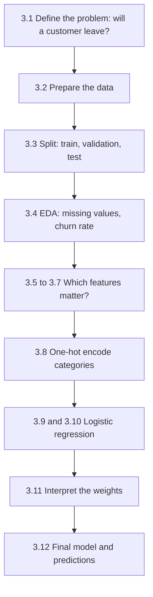
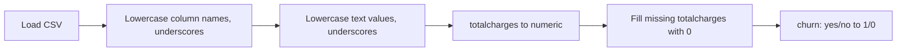
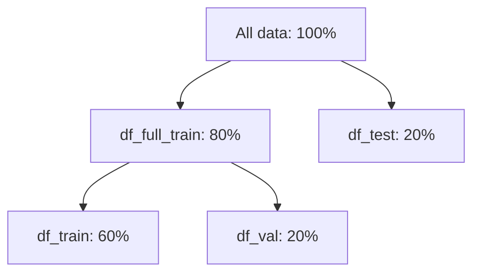
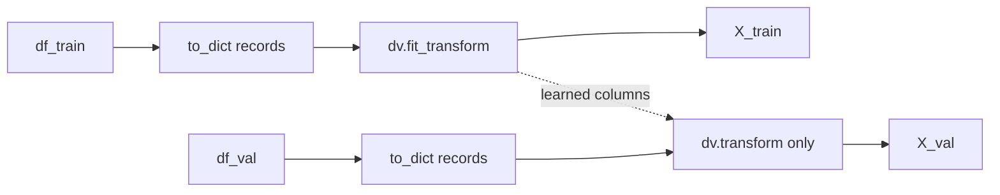
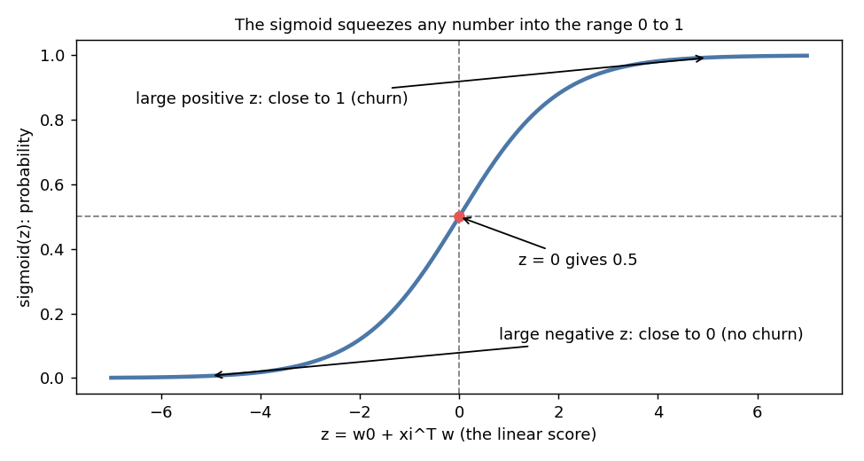
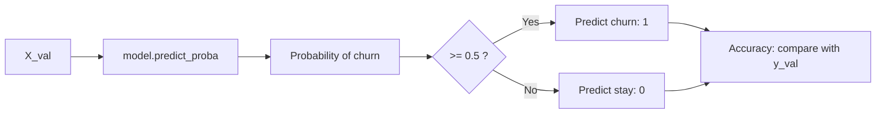
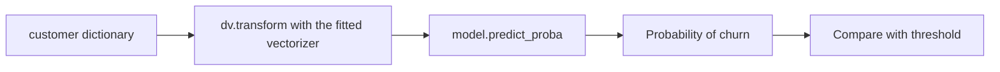

# Week 3: Machine Learning for Classification (Churn Prediction)

**ML Zoomcamp, chapter 3 (lessons 3.1 to 3.12)**

- Course folder: https://github.com/DataTalksClub/machine-learning-zoomcamp/tree/main/03-classification
- Dataset (Kaggle, Telco Customer Churn): https://www.kaggle.com/blastchar/telco-customer-churn
- Dataset copy used in the course: https://raw.githubusercontent.com/alexeygrigorev/mlbookcamp-code/master/chapter-03-churn-prediction/WA_Fn-UseC_-Telco-Customer-Churn.csv

> Formula tip: formulas are written as LaTeX (`$$` block) and again in plain text underneath, so the notes stay readable in editors that do not render math.

> Note on sources: this file is a one-page summary of the whole chapter. The code follows the standard course notebook and was run end to end on synthetic customer data. Check the numbers against your own notebook and the course videos.

## Contents

1. [Churn prediction project (3.1)](#31-churn-prediction-project)
2. [Data preparation (3.2)](#32-data-preparation)
3. [Validation framework (3.3)](#33-setting-up-the-validation-framework)
4. [EDA (3.4)](#34-eda)
5. [Churn rate and risk ratio (3.5)](#35-feature-importance-churn-rate-and-risk-ratio)
6. [Mutual information (3.6)](#36-feature-importance-mutual-information)
7. [Correlation (3.7)](#37-feature-importance-correlation)
8. [One-hot encoding (3.8)](#38-one-hot-encoding)
9. [Logistic regression (3.9)](#39-logistic-regression)
10. [Training with Scikit-Learn (3.10)](#310-training-logistic-regression-with-scikit-learn)
11. [Model interpretation (3.11)](#311-model-interpretation)
12. [Using the model (3.12)](#312-using-the-model)
13. [Cheat sheet and takeaways](#cheat-sheet)

---

## The big picture



---

## Terms explained

**Classification**
Supervised learning where the target is a **category**. Regression predicts a number, classification predicts a label.

**Binary classification**
Classification with exactly two classes. Here: churn (1) or no churn (0).

**Churn**
A customer leaving the service. Churn prediction finds customers likely to leave, so the company can try to keep them (for example with a discount).

**Churn rate**
The share of customers who churned. A mean of a 0/1 column gives it directly.

**Risk ratio**
The churn rate of a group divided by the global churn rate. Above 1 means the group is riskier than average.

**Mutual information**
A score of how much knowing one variable tells you about another. 0 means no relation. Higher means a stronger relation.

**Correlation**
For two numeric variables, a number from -1 to 1 showing how they move together.

**One-hot encoding**
Turning a categorical column into several 0/1 columns, one per category value.

**Logistic regression**
A classification model. It computes a linear score and passes it through the sigmoid function to get a **probability**.

**Sigmoid**
The function that squeezes any number into the range 0 to 1.

**Probability vs. decision**
The model outputs a probability, such as 0.79. We turn it into a yes/no decision by comparing with a **threshold** (0.5 by default).

**Accuracy**
The share of correct decisions. It is the fraction of rows where the prediction equals the real label.

**Bias (intercept)**
The baseline score when all features are 0.

**Hard vs. soft prediction**
Hard: just the label (0 or 1). Soft: the probability.

---

## 3.1 Churn prediction project

**Scenario:** a telecom company wants to know which customers will leave. For each customer we have a description (contract, services, charges, tenure) and know whether the customer left.

**Goal:** a model that outputs the **probability of churn** for a customer.

$$
g(x_i) \approx y_i, \qquad y_i \in \{0, 1\}
$$

Plain text:

```
g(xi) ≈ yi,   yi is 0 (stays) or 1 (churns)
```

- `xi` is the feature vector of customer i
- `yi` is 1 if the customer churned, else 0
- `g` outputs a probability between 0 and 1

**Use of the output:** send retention offers to customers with a high probability.

Download the data:

```
wget https://raw.githubusercontent.com/alexeygrigorev/mlbookcamp-code/master/chapter-03-churn-prediction/WA_Fn-UseC_-Telco-Customer-Churn.csv
```

---

## 3.2 Data preparation

Typical cleaning steps, in order:



```python
import pandas as pd
import numpy as np

df = pd.read_csv('WA_Fn-UseC_-Telco-Customer-Churn.csv')

df.columns = df.columns.str.lower().str.replace(' ', '_')

string_columns = list(df.select_dtypes(include=['object', 'string']).columns)

for col in string_columns:
    df[col] = df[col].str.lower().str.replace(' ', '_')
```

> **pandas 3 note:** in pandas 3 text columns have a dedicated `str` dtype, so the older check `df.dtypes == 'object'` finds nothing. `select_dtypes(include=['object', 'string'])` works on old and new pandas.

### The totalcharges problem

`totalcharges` should be numeric but is read as text, because a few rows contain a blank space (new customers with no charges yet). Convert it and turn the unparseable values into missing values:

```python
tc = pd.to_numeric(df.totalcharges, errors='coerce')
tc.isnull().sum()
```

`errors='coerce'` means "put NaN where conversion fails" instead of raising an error. The count shows how many values were blank. Fill them with 0 and store the column back:

```python
df.totalcharges = tc.fillna(0)
```

### The target column

`churn` contains `yes` and `no`. Models need numbers, so convert to 1 and 0:

```python
df.churn = (df.churn == 'yes').astype(int)
```

`df.churn == 'yes'` gives True/False and `.astype(int)` makes it 1/0. With this encoding, the **mean** of the column equals the churn rate.

---

## 3.3 Setting up the validation framework

In week 2 we split the data by hand. Scikit-Learn has a function for it:

```python
from sklearn.model_selection import train_test_split

df_full_train, df_test = train_test_split(df, test_size=0.2, random_state=1)
df_train, df_val = train_test_split(df_full_train, test_size=0.25, random_state=1)
```

Why `0.25` for the second split: after taking 20% for test, 80% remains. 25% of 80% is 20% of the total, so the result is **60% train, 20% validation, 20% test**.

`random_state=1` makes the shuffle reproducible.



Reset the indexes, take the targets out, and remove the target column from the features:

```python
df_train = df_train.reset_index(drop=True)
df_val = df_val.reset_index(drop=True)
df_test = df_test.reset_index(drop=True)

y_train = df_train.churn.values
y_val = df_val.churn.values
y_test = df_test.churn.values

del df_train['churn']
del df_val['churn']
del df_test['churn']
```

Deleting `churn` from the features avoids **data leakage**: the model must not see the answer.

---

## 3.4 EDA

Work with `df_full_train` (train + validation). The test set stays untouched.

```python
df_full_train = df_full_train.reset_index(drop=True)
```

### Checklist

```python
df_full_train.isnull().sum()
```

No missing values should remain. Then the target distribution:

```python
df_full_train.churn.value_counts(normalize=True)
```

`normalize=True` gives shares instead of counts. The share of ones is the **global churn rate**:

```python
global_churn_rate = df_full_train.churn.mean()
round(global_churn_rate, 2)
```

The classes are **imbalanced**: far fewer customers churn than stay. That matters later when we choose evaluation metrics (week 4).

### Split the columns by type

```python
numerical = ['tenure', 'monthlycharges', 'totalcharges']

categorical = [
    'gender', 'seniorcitizen', 'partner', 'dependents',
    'phoneservice', 'multiplelines', 'internetservice',
    'onlinesecurity', 'onlinebackup', 'deviceprotection',
    'techsupport', 'streamingtv', 'streamingmovies',
    'contract', 'paperlessbilling', 'paymentmethod',
]
```

`seniorcitizen` is stored as 0/1 but behaves like a category. See how many distinct values each categorical column has:

```python
df_full_train[categorical].nunique()
```

Every categorical column has only 2 to 4 values, so one-hot encoding stays small.

---

## 3.5 Feature importance: churn rate and risk ratio

**Question:** which features separate churners from non-churners? We compare the churn rate **inside a group** with the global churn rate.

### Example: gender

```python
female_mean = df_full_train[df_full_train.gender == 'female'].churn.mean()
male_mean = df_full_train[df_full_train.gender == 'male'].churn.mean()
```

Both are close to the global rate, so gender carries little information.

### Two ways to compare

**Difference**

$$
\text{difference} = \text{group rate} - \text{global rate}
$$

Plain text:

```
difference = group rate - global rate
```

- Positive: the group churns **more** than average
- Negative: the group churns **less**

**Risk ratio**

$$
\text{risk ratio} = \frac{\text{group rate}}{\text{global rate}}
$$

Plain text:

```
risk ratio = group rate / global rate
```

- Greater than 1: higher risk than average
- Less than 1: lower risk
- Around 1: no difference

### Do it for a whole column

```python
df_group = df_full_train.groupby('contract').churn.agg(['mean', 'count'])
df_group['diff'] = df_group['mean'] - global_churn_rate
df_group['risk'] = df_group['mean'] / global_churn_rate
df_group
```

Typical pattern: month-to-month contracts have a risk ratio **above 1**, two-year contracts **below 1**. Contract type is clearly an important feature.

### Loop over all categorical columns

```python
for col in categorical:
    df_group = df_full_train.groupby(col).churn.agg(['mean', 'count'])
    df_group['diff'] = df_group['mean'] - global_churn_rate
    df_group['risk'] = df_group['mean'] / global_churn_rate
    print(col)
    print(df_group)
    print()
```

Watch the `count` column. A group with very few customers can show an extreme rate by chance.

---

## 3.6 Feature importance: mutual information

Risk ratios are hard to compare across columns, because each column has its own groups. **Mutual information (MI)** gives **one number per column**.

$$
MI(X, Y) = \sum_{x} \sum_{y} p(x, y) \log \frac{p(x, y)}{p(x)\, p(y)}
$$

Plain text:

```
MI(X, Y) = sum over x and y of  p(x,y) * log( p(x,y) / ( p(x) * p(y) ) )
```

Intuition:

- If X and Y are **independent**, then `p(x,y) = p(x) p(y)`, the log is 0, and MI is 0
- The more X tells us about Y, the larger MI is
- MI is never negative

```python
from sklearn.metrics import mutual_info_score

mutual_info_score(df_full_train.churn, df_full_train.contract)
```

Apply it to all categorical columns and sort:

```python
def calculate_mi(series):
    return mutual_info_score(series, df_full_train.churn)

df_mi = df_full_train[categorical].apply(calculate_mi)
df_mi = df_mi.sort_values(ascending=False).to_frame(name='MI')
df_mi
```

Columns such as `contract`, `onlinesecurity` and `techsupport` usually score high. `gender` and `phoneservice` score near 0.

Limit: MI works on categorical variables, so it does not apply directly to the numeric columns. Correlation covers those.

---

## 3.7 Feature importance: correlation

For numeric features we use the **correlation coefficient** with the target.

$$
r = \frac{\sum_i (x_i - \bar{x})(y_i - \bar{y})}{\sqrt{\sum_i (x_i - \bar{x})^2}\; \sqrt{\sum_i (y_i - \bar{y})^2}}
$$

Plain text:

```
r = sum( (xi - mean_x) * (yi - mean_y) ) / ( sqrt(sum((xi - mean_x)²)) * sqrt(sum((yi - mean_y)²)) )
```

How to read `r`:

| Value | Meaning |
|-------|---------|
| Positive | When the feature grows, churn becomes **more** likely |
| Negative | When the feature grows, churn becomes **less** likely |
| Near 0 | No linear relation |
| Near -1 or 1 | Strong relation |

```python
df_full_train[numerical].corrwith(df_full_train.churn)
```

Typical result: `tenure` has a **negative** correlation (long-term customers rarely leave), `monthlycharges` has a **positive** one (expensive plans churn more). `totalcharges` is also negative, since it grows with tenure.

Correlation measures **linear** relations only. A correlation near 0 does not rule out a non-linear relation.

---

## 3.8 One-hot encoding

Models need numbers, so each category becomes its own 0/1 column.

| contract | contract=month-to-month | contract=one_year | contract=two_year |
|----------|------------------------|-------------------|-------------------|
| month-to-month | 1 | 0 | 0 |
| two_year | 0 | 0 | 1 |

We use Scikit-Learn's `DictVectorizer`. It takes a list of dictionaries (one per customer) and:

- one-hot encodes the **string** values
- leaves **numeric** values unchanged

```python
from sklearn.feature_extraction import DictVectorizer

train_dict = df_train[categorical + numerical].to_dict(orient='records')
```

`orient='records'` gives one dictionary per row, for example `{'gender': 'female', 'tenure': 1, ...}`.

```python
dv = DictVectorizer(sparse=False)
dv.fit(train_dict)

X_train = dv.transform(train_dict)
```

Short form, same result: `X_train = dv.fit_transform(train_dict)`.

Look at what was created:

```python
dv.get_feature_names_out()
X_train.shape
```

Column names look like `contract=month-to-month`, and numeric columns keep their names.

### Apply the same encoding to validation data

```python
val_dict = df_val[categorical + numerical].to_dict(orient='records')
X_val = dv.transform(val_dict)
```

**Important:** on validation and test data use only `transform`, never `fit`. The vectorizer learned the categories from the training data, and the validation matrix must have exactly the same columns.



---

## 3.9 Logistic regression

Linear regression gives any number, such as 7.3 or -2. For churn we need a **probability** between 0 and 1. Logistic regression takes the linear score and squeezes it with the **sigmoid**.

**The sigmoid function**

$$
\sigma(z) = \frac{1}{1 + e^{-z}}
$$

Plain text:

```
sigmoid(z) = 1 / (1 + e^(-z))
```

**The model**

$$
g(x_i) = \sigma(w_0 + x_i^T w)
$$

Plain text:

```
g(xi) = sigmoid( w0 + xiᵀ w )
```

with the linear score

$$
z = w_0 + x_{i1} w_1 + x_{i2} w_2 + \dots + x_{in} w_n
$$

Plain text:

```
z = w0 + xi1*w1 + xi2*w2 + ... + xin*wn
```



How the sigmoid behaves:

- `z = 0` gives exactly 0.5
- large positive `z` gives a value close to 1
- large negative `z` gives a value close to 0

### Linear vs. logistic

| | Linear regression | Logistic regression |
|-|-------------------|---------------------|
| Target | Number (price) | 0 or 1 (churn) |
| Output | Any real number | Probability from 0 to 1 |
| Formula | `w0 + xiᵀ w` | `sigmoid(w0 + xiᵀ w)` |

### Code

```python
def sigmoid(z):
    return 1 / (1 + np.exp(-z))

def linear_regression(xi):
    result = w0
    for j in range(len(w)):
        result = result + xi[j] * w[j]
    return result

def logistic_regression(xi):
    score = w0
    for j in range(len(w)):
        score = score + xi[j] * w[j]
    return sigmoid(score)
```

The only difference is the last step: the result goes through `sigmoid`.

```python
sigmoid(np.array([-5, 0, 5]))
```

Output (rounded):

```
array([0.0067, 0.5, 0.9933])
```

---

## 3.10 Training logistic regression with Scikit-Learn

In week 2 we implemented training ourselves (the normal equation). Logistic regression has no such closed form, so we use the library, which finds the weights by an iterative solver.

```python
from sklearn.linear_model import LogisticRegression

model = LogisticRegression(solver='liblinear', random_state=1)
model.fit(X_train, y_train)
```

`solver='liblinear'` selects a solver that works well for small datasets. `random_state` keeps the result reproducible. (Defaults differ between Scikit-Learn versions, so setting the solver explicitly gives the same behavior everywhere.)

### The learned parameters

```python
model.intercept_[0]   # the bias w0
model.coef_[0]        # the weights w
```

### Soft predictions (probabilities)

```python
y_pred = model.predict_proba(X_val)
y_pred[:5]
```

`predict_proba` returns two columns: the probability of class 0 (no churn) and class 1 (churn). We need the second one:

```python
y_pred = model.predict_proba(X_val)[:, 1]
```

### Hard predictions (decisions)

Compare with a threshold of 0.5:

```python
churn_decision = (y_pred >= 0.5)
```

Customers with `True` are the ones we would send the retention offer to.

### Accuracy

The share of correct decisions:

```python
(y_val == churn_decision).mean()
```

How it works: `y_val == churn_decision` is a True/False array, where True means the prediction was right. The mean of True/False values is the share of Trues.

You can also let the model decide with `model.predict(X_val)`, which uses the same 0.5 threshold.



Accuracy alone can mislead on imbalanced data: a model that always says "no churn" already scores well when most customers stay. Week 4 covers better metrics.

---

## 3.11 Model interpretation

Which feature pushes the prediction up or down? Look at the weights next to their feature names:

```python
dict(zip(dv.get_feature_names_out(), model.coef_[0].round(3)))
```

How to read a weight:

- **Positive:** the feature raises the churn score. `contract=month-to-month` has a positive weight.
- **Negative:** the feature lowers it. `contract=two_year` has a negative weight.
- Magnitude shows strength, but only compare weights of features on a similar scale (a 0/1 flag against `monthlycharges` is not comparable).

### Understanding the formula with a small model

Train a model on only three features:

```python
small = ['contract', 'tenure', 'monthlycharges']

df_train[small].iloc[:10].to_dict(orient='records')
```

```python
dicts_train_small = df_train[small].to_dict(orient='records')
dicts_val_small = df_val[small].to_dict(orient='records')

dv_small = DictVectorizer(sparse=False)
dv_small.fit(dicts_train_small)

X_train_small = dv_small.transform(dicts_train_small)

model_small = LogisticRegression(solver='liblinear', random_state=1)
model_small.fit(X_train_small, y_train)
```

```python
w0 = model_small.intercept_[0]
w = model_small.coef_[0]

dict(zip(dv_small.get_feature_names_out(), w.round(3)))
```

Now every prediction can be computed by hand:

$$
\text{churn probability} = \sigma\big(w_0 + \text{sum of the weights of the active features}\big)
$$

Plain text:

```
probability = sigmoid( w0 + sum of the weights of the features that apply )
```

For a customer on a month-to-month contract, with tenure 10 and monthly charges 70, add `w0`, the month-to-month weight, `10 * w_tenure` and `70 * w_monthlycharges`, then apply the sigmoid. Weights of one-hot columns that are 0 add nothing.

---

## 3.12 Using the model

### Step 1: train the final model on train + validation

```python
dicts_full_train = df_full_train[categorical + numerical].to_dict(orient='records')

dv = DictVectorizer(sparse=False)
X_full_train = dv.fit_transform(dicts_full_train)

y_full_train = df_full_train.churn.values

model = LogisticRegression(solver='liblinear', random_state=1)
model.fit(X_full_train, y_full_train)
```

### Step 2: check once on the test set

```python
dicts_test = df_test[categorical + numerical].to_dict(orient='records')
X_test = dv.transform(dicts_test)

y_pred = model.predict_proba(X_test)[:, 1]
churn_decision = (y_pred >= 0.5)

(churn_decision == y_test).mean()
```

The result should be close to the validation accuracy. If it is far worse, something is wrong, such as overfitting to the validation set.

### Step 3: predict for one new customer

A customer arrives as a dictionary, for example from a web form. Every key used in training must be present:

```python
customer = {
    'gender': 'female',
    'seniorcitizen': 0,
    'partner': 'yes',
    'dependents': 'no',
    'phoneservice': 'no',
    'multiplelines': 'no_phone_service',
    'internetservice': 'dsl',
    'onlinesecurity': 'no',
    'onlinebackup': 'yes',
    'deviceprotection': 'no',
    'techsupport': 'no',
    'streamingtv': 'no',
    'streamingmovies': 'no',
    'contract': 'month-to-month',
    'paperlessbilling': 'yes',
    'paymentmethod': 'electronic_check',
    'tenure': 1,
    'monthlycharges': 29.85,
    'totalcharges': 29.85,
}
```

Note the value format: lowercase with underscores, exactly like the cleaned training data.

```python
X_small = dv.transform([customer])
model.predict_proba(X_small)[0, 1]
```

Details:

- `[customer]` wraps the dictionary in a list, because `transform` expects a list of dictionaries
- `[0, 1]` takes the first (only) row and the probability of class 1
- the result is a probability, such as 0.4 or 0.8. Compare it with your threshold to decide



### Things that can go wrong

| Problem | Cause | Fix |
|---------|-------|-----|
| Different number of columns than in training | Called `fit` on validation or test data | Use `transform` only, with the vectorizer fitted on training data |
| Weird or low probability for obvious churners | Value spelling differs (`Month-to-month` vs `month-to-month`) | Apply the same cleaning to new data |
| Column names missing from the result | A key is missing in the dictionary | Provide every feature used in training |
| Result is a 2-column array | Used `predict_proba` without `[:, 1]` | Select the churn column |

---

## Cheat sheet

| Task | Code |
|------|------|
| Text columns to lowercase | `df[col].str.lower().str.replace(' ', '_')` |
| Convert to number, blanks become NaN | `pd.to_numeric(s, errors='coerce')` |
| Target as 0/1 | `(df.churn == 'yes').astype(int)` |
| Split data | `train_test_split(df, test_size=0.2, random_state=1)` |
| Churn rate | `df.churn.mean()` |
| Rate by group | `df.groupby(col).churn.agg(['mean', 'count'])` |
| Mutual information | `mutual_info_score(df.churn, df[col])` |
| Correlation with target | `df[numerical].corrwith(df.churn)` |
| One-hot encoding | `DictVectorizer(sparse=False)` with `fit_transform` and `transform` |
| Train | `LogisticRegression(solver='liblinear').fit(X, y)` |
| Probabilities | `model.predict_proba(X)[:, 1]` |
| Decisions | `probabilities >= 0.5` |
| Accuracy | `(y == decision).mean()` |
| Weights with names | `dict(zip(dv.get_feature_names_out(), model.coef_[0]))` |

---

## Key takeaways

- Classification predicts a **category**. For churn we predict the **probability** that a customer leaves.
- Prepare the data first: clean names and values, fix `totalcharges`, and encode `churn` as 1/0.
- Use `train_test_split` twice to get a 60/20/20 split.
- EDA: check missing values, the **global churn rate** and class imbalance.
- **Churn rate and risk ratio** compare groups with the global rate. **Mutual information** ranks categorical features. **Correlation** ranks numeric features.
- **One-hot encode** with `DictVectorizer`: `fit_transform` on train, only `transform` on validation, test and new data.
- **Logistic regression** is linear regression followed by the **sigmoid**, so the output is a probability.
- Turn probabilities into decisions with a threshold (default 0.5). Accuracy is the share of correct decisions.
- Weights can be read directly: positive raises churn probability, negative lowers it.
- The final model trains on train + validation, gets checked once on test, and then scores new customers.
- Accuracy alone can mislead on imbalanced data. Week 4 introduces better evaluation metrics.

---

## Navigation

- Previous: Chapter 2, Machine Learning for Regression
- Next: Chapter 4, Evaluation Metrics for Classification
