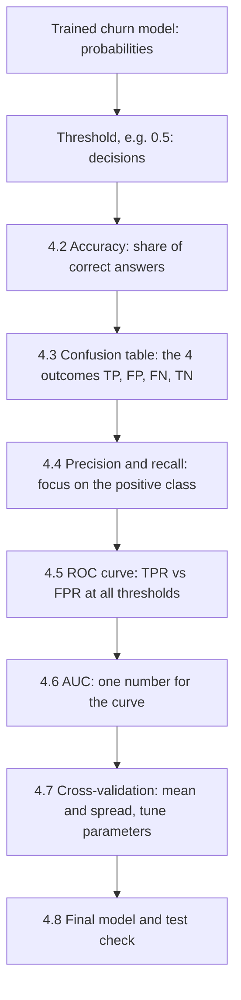
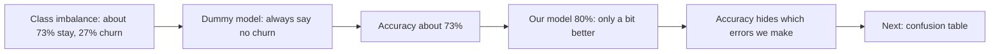
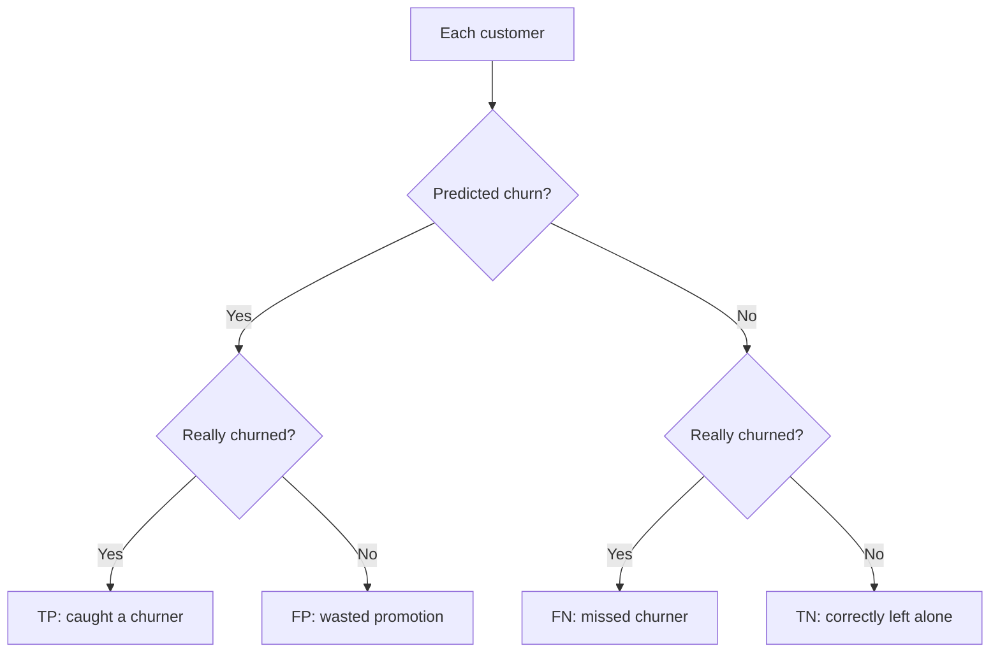
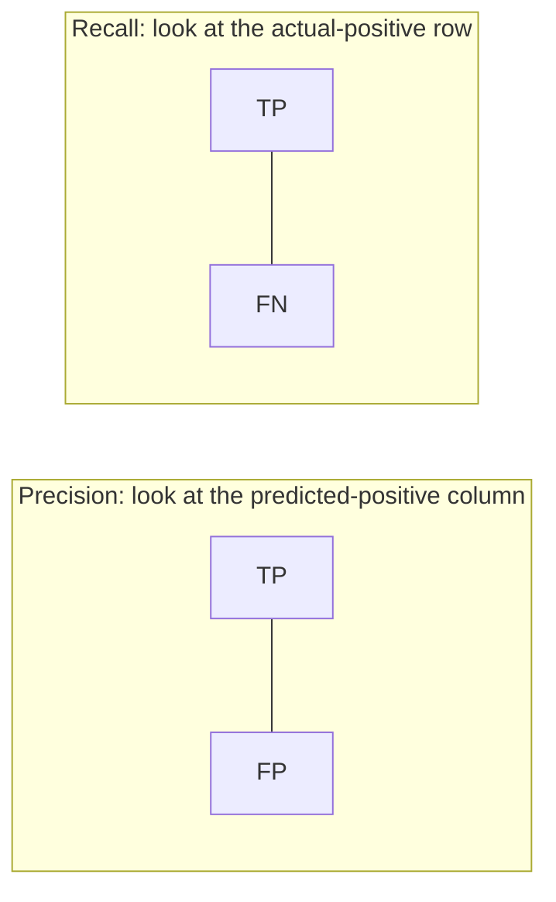
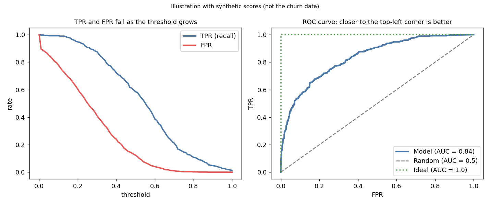
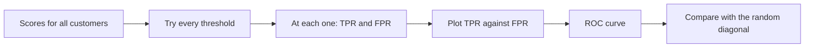
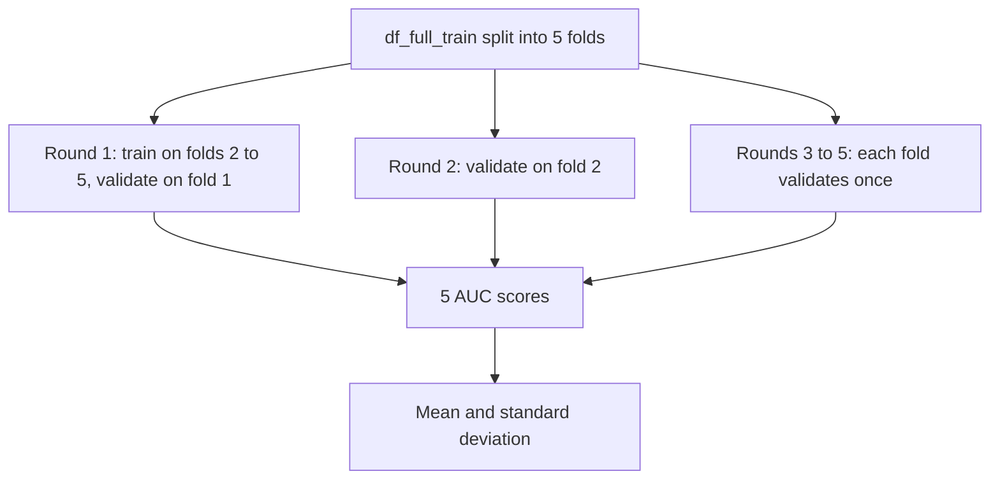
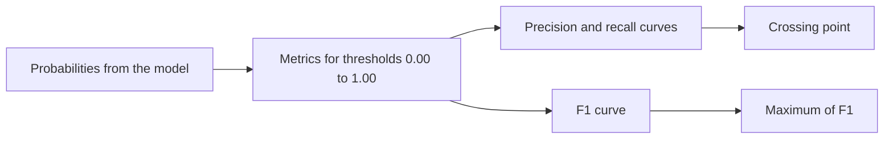

# Week 4: Evaluation Metrics for Classification

**ML Zoomcamp, chapter 4 (lessons 4.1 to 4.8)**

- Course folder: https://github.com/DataTalksClub/machine-learning-zoomcamp/tree/main/04-evaluation
- Notebook used in the lessons: https://github.com/DataTalksClub/machine-learning-zoomcamp/blob/main/04-evaluation/notebook.ipynb
- Dataset (Kaggle, Telco Customer Churn): https://www.kaggle.com/blastchar/telco-customer-churn
- Slides for the ROC lesson: https://www.slideshare.net/AlexeyGrigorev/ml-zoomcamp-4-evaluation-metrics-for-classification

> Formula tip: formulas are written as LaTeX (`$$` block) and again in plain text underneath, so the notes stay readable in editors that do not render math.

> Source note: lessons 4.1 and 4.3 to 4.8 were read from the course pages. The accuracy lesson (4.2) could not be opened, so its section is built from the numbers and code quoted in the other lessons. Check it against the video.

## Contents

1. [Overview: what is a metric (4.1)](#41-overview)
2. [Accuracy (4.2)](#42-accuracy)
3. [Confusion table (4.3)](#43-confusion-table)
4. [Precision and recall (4.4)](#44-precision-and-recall)
5. [ROC curves (4.5)](#45-roc-curves)
6. [ROC AUC (4.6)](#46-roc-auc)
7. [Cross-validation (4.7)](#47-cross-validation)
8. [Summary (4.8)](#48-summary)
9. [Extra: F1 score and picking a threshold](#extra-f1-score-and-picking-a-threshold)
10. [Cheat sheet and takeaways](#cheat-sheet)

---

## The big picture

In week 3 we trained a churn model. Week 4 answers the question: **is it any good?** One fixed model gets looked at from several angles.



---

## Terms explained

**Metric**
A function that takes the predictions and the true values and returns **one number** telling how good the predictions are.

**Threshold**
The probability cutoff that turns a score into a decision. At 0.5, a customer with probability 0.5 or higher is predicted to churn.

**Positive class**
The class we care about finding. Here: churn (1).

**TP, FP, FN, TN**
True positive, false positive, false negative, true negative. "Positive or negative" is what we predicted, "true or false" is whether we were right.

**Accuracy**
The share of all predictions that are correct.

**Precision**
Of the customers we predicted to churn, the share that really churned.

**Recall (TPR, sensitivity)**
Of the customers who really churned, the share we caught.

**FPR (false positive rate)**
Of the customers who stayed, the share we wrongly flagged as churners.

**ROC curve**
A plot of TPR against FPR over all thresholds. ROC means Receiver Operating Characteristic, a name from radar detection in the Second World War.

**AUC (area under the curve)**
The area under the ROC curve: a single number from 0.5 (random) to 1.0 (perfect).

**Class imbalance**
One class is much rarer than the other. Churners are only about 27% of the customers.

**Cross-validation (k-fold)**
Evaluating the same model on several different train and validation splits, to get a mean and a spread instead of a single number.

**Dummy model**
A model that ignores the features, for example always predicting "no churn". A useful sanity check.

---

## 4.1 Overview

**What a metric is:** predictions go in, true values go in, one number comes out. Different metrics look at different aspects of the predictions, and choosing the right one for the problem is what this week is about.

**The scenario:** a telecom company sends a promotional email to customers whose churn score is 0.5 or higher. The model should find the customers who are about to leave.

### Recap of the setup from week 3

The lessons start by rebuilding the trained model. The data preparation is the same as in week 3:

```python
import pandas as pd
import numpy as np

from sklearn.model_selection import train_test_split
from sklearn.feature_extraction import DictVectorizer
from sklearn.linear_model import LogisticRegression

df = pd.read_csv('data-week-3.csv')

df.columns = df.columns.str.lower().str.replace(' ', '_')

categorical_columns = list(df.select_dtypes(include=['object', 'string']).columns)

for c in categorical_columns:
    df[c] = df[c].str.lower().str.replace(' ', '_')

df.totalcharges = pd.to_numeric(df.totalcharges, errors='coerce')
df.totalcharges = df.totalcharges.fillna(0)

df.churn = (df.churn == 'yes').astype(int)
```

> **pandas 3 note:** the lesson code uses `df.dtypes == 'object'`. In pandas 3, text columns have a dedicated `str` dtype, so that check finds nothing. `select_dtypes(include=['object', 'string'])` works on old and new pandas.

The split is 60% train, 20% validation, 20% test, with `random_state=1`:

```python
df_full_train, df_test = train_test_split(df, test_size=0.2, random_state=1)
df_train, df_val = train_test_split(df_full_train, test_size=0.25, random_state=1)
```

The model uses 3 numerical and 16 categorical features, one-hot encoded with `DictVectorizer(sparse=False)`, and a logistic regression. At the end of the recap we have probabilities for the validation set:

```python
y_pred = model.predict_proba(X_val)[:, 1]
churn_decision = (y_pred >= 0.5)
(y_val == churn_decision).mean()
```

In the lesson this gives about **0.8034**: the model agrees with the real outcome for around 80% of the customers. Whether that is good is exactly the question we cannot answer yet.

---

## 4.2 Accuracy

**Accuracy** is the share of correct predictions:

$$
\text{accuracy} = \frac{\text{number of correct predictions}}{\text{number of all predictions}}
$$

Plain text:

```
accuracy = correct predictions / all predictions
```

Two equivalent ways to compute it:

```python
(y_val == churn_decision).mean()
```

```python
from sklearn.metrics import accuracy_score

accuracy_score(y_val, y_pred >= 0.5)
```

### Accuracy at different thresholds

The threshold 0.5 is only a default. We can try many thresholds and see how accuracy changes:

```python
import matplotlib.pyplot as plt

thresholds = np.linspace(0, 1, 21)
scores = []

for t in thresholds:
    score = accuracy_score(y_val, y_pred >= t)
    scores.append(score)

plt.plot(thresholds, scores)
```

Two edge cases explain the shape of the curve:

- **Threshold 0:** everybody gets a score of 0 or more, so everyone is predicted to churn. Accuracy equals the share of churners, about 27%.
- **Threshold 1:** nobody is predicted to churn. Accuracy equals the share of non-churners, about 73%.

### The dummy model

A model that predicts "no churn" for everyone (threshold 1) scores about **73%**, because most customers stay. Our model's 80% is only roughly 7 to 8 points above this lazy baseline.



**Lesson:** with imbalanced classes, accuracy can look decent while hiding poor performance on the class we care about.

---

## 4.3 Confusion table

Accuracy collapses everything into one number. The **confusion table** shows what kinds of mistakes the model makes.

### Four outcomes

| Prediction | Actual | Name |
|------------|--------|------|
| Will churn (positive) | Churned | True Positive (TP) |
| Will churn (positive) | Did not churn | False Positive (FP) |
| Will not churn (negative) | Churned | False Negative (FN) |
| Will not churn (negative) | Did not churn | True Negative (TN) |

- **False positive:** we sent a promotion to a customer who was never going to leave. A wasted discount.
- **False negative:** a customer left and we never flagged them. Often the more costly mistake.

### Computing the counts

```python
actual_positive = (y_val == 1)
actual_negative = (y_val == 0)

t = 0.5
predict_positive = (y_pred >= t)
predict_negative = (y_pred < t)

tp = (predict_positive & actual_positive).sum()
tn = (predict_negative & actual_negative).sum()

fp = (predict_positive & actual_negative).sum()
fn = (predict_negative & actual_positive).sum()
```

The `&` operator is the element-wise logical AND. Each count is the number of customers for whom both conditions hold at once.

### The table

```python
confusion_matrix = np.array([
    [tn, fp],
    [fn, tp]
])
confusion_matrix
```

In the lesson the output is:

```
array([[922, 101],
       [176, 210]])
```

|  | Predicted negative | Predicted positive |
|--|--------------------|--------------------|
| **Actual negative** | TN = 922 | FP = 101 |
| **Actual positive** | FN = 176 | TP = 210 |

The four numbers add up to 1409, the size of the validation set. Dividing by the total gives shares:

```python
(confusion_matrix / confusion_matrix.sum()).round(2)
```

```
array([[0.65, 0.07],
       [0.12, 0.15]])
```

So 65% are true negatives, 7% false positives, 12% false negatives and 15% true positives.

**Accuracy fits back in:**

$$
\text{accuracy} = \frac{TP + TN}{TP + TN + FP + FN}
$$

Plain text:

```
accuracy = (TP + TN) / (TP + TN + FP + FN)  =  (210 + 922) / 1409  =  0.8034
```

What the table adds is the split of the remaining 20% into 7% false positives and 12% false negatives, two errors with different business costs.



---

## 4.4 Precision and recall

Both metrics focus on the positive class, and both see what accuracy hides.

### Precision

Of the positive predictions, how many are right? It uses the **predicted positive column** of the table (TP and FP):

$$
P = \frac{TP}{TP + FP}
$$

Plain text:

```
P = TP / (TP + FP)
```

```python
p = tp / (tp + fp)
p
```

In the lesson this is about **0.675** (67%). We emailed 210 + 101 = 311 customers. Only 210 were really going to leave, so about a third of the emails went to customers who were never at risk.

### Recall

Of the real positives, how many did we find? It uses the **actual positive row** of the table (TP and FN):

$$
R = \frac{TP}{TP + FN}
$$

Plain text:

```
R = TP / (TP + FN)
```

```python
r = tp / (tp + fn)
r
```

In the lesson this is about **0.544** (54%). 386 customers really churned (210 + 176), but we flagged only 210. The other 176, around 46% of all churners, left without any action from us.

### Why this beats accuracy

| Metric | Value | What it says |
|--------|-------|--------------|
| Accuracy | 80% | Looks fine |
| Precision | 67% | Two thirds of our alerts are real |
| Recall | 54% | We miss almost half of the people who leave |

Churners are only about 27% of the data, so the false negatives barely move accuracy, yet they are half of the customers we care about. **With imbalanced classes (churn, fraud, medical diagnosis) look at precision and recall.**

### Mnemonics

- **Precision:** from the **pre**dicted positives, how many did we get right. "Pre" as in prediction.
- **Recall:** from the **real** positives, how many did we find. "Re" and "al" as in real.



---

## 4.5 ROC curves

Precision and recall describe the model at **one** threshold. A **ROC curve** looks at **all thresholds at once**.

### TPR and FPR

**True positive rate** is the same as recall. We want to maximize it:

$$
TPR = \frac{TP}{TP + FN}
$$

Plain text:

```
TPR = TP / (TP + FN)
```

**False positive rate** is the share of real negatives we got wrong. We want to minimize it:

$$
FPR = \frac{FP}{FP + TN}
$$

Plain text:

```
FPR = FP / (FP + TN)
```

```python
tpr = tp / (tp + fn)
fpr = fp / (fp + tn)
```

At threshold 0.5 in the lesson: TPR is about 0.544 (same as recall) and FPR is about 0.099, so we bother roughly 10% of customers who would never churn.

### TPR and FPR for all thresholds

Loop over 101 thresholds from 0 to 1 and record the four counts for each:

```python
scores = []

thresholds = np.linspace(0, 1, 101)

for t in thresholds:
    actual_positive = (y_val == 1)
    actual_negative = (y_val == 0)

    predict_positive = (y_pred >= t)
    predict_negative = (y_pred < t)

    tp = (predict_positive & actual_positive).sum()
    tn = (predict_negative & actual_negative).sum()

    fp = (predict_positive & actual_negative).sum()
    fn = (predict_negative & actual_positive).sum()

    scores.append((t, tp, fp, fn, tn))

columns = ['threshold', 'tp', 'fp', 'fn', 'tn']
df_scores = pd.DataFrame(scores, columns=columns)

df_scores['tpr'] = df_scores.tp / (df_scores.tp + df_scores.fn)
df_scores['fpr'] = df_scores.fp / (df_scores.fp + df_scores.tn)
```

```python
plt.plot(df_scores.threshold, df_scores['tpr'], label='TPR')
plt.plot(df_scores.threshold, df_scores['fpr'], label='FPR')
plt.legend()
```

As the threshold grows, we flag fewer customers, so **both rates fall**.



The picture is an illustration with synthetic scores. The left panel shows both rates falling, the right panel shows the ROC curve with the random and ideal reference lines.

### Two reference models

A curve needs something to compare against.

**The random model:** random scores between 0 and 1. Its accuracy is about 50%, a coin flip. At any threshold, the share of positives it catches equals the share of negatives it bothers, so it cannot tell the groups apart.

```python
np.random.seed(1)
y_rand = np.random.uniform(0, 1, size=len(y_val))
```

**The ideal model:** every churner has a higher score than every non-churner. We can build one by hand, with all negatives first, then all positives, and scores spread evenly from 0 to 1:

```python
num_neg = (y_val == 0).sum()
num_pos = (y_val == 1).sum()

y_ideal = np.repeat([0, 1], [num_neg, num_pos])
y_ideal_pred = np.linspace(0, 1, len(y_val))
```

The best threshold for the ideal model is the share of negatives (0.726 in the lesson), where it reaches accuracy 1.0. Its TPR stays at 1.0 until that point and its FPR drops to 0.

`np.repeat([0, 1], [a, b])` returns `a` zeros followed by `b` ones.

### The ROC curve

The ROC curve plots **TPR against FPR**, not against the threshold. Each point is the model at one threshold:

- bottom-left corner: flag almost nobody (conservative)
- top-right corner: flag everybody

```python
plt.figure(figsize=(5, 5))

plt.plot(df_scores.fpr, df_scores.tpr, label='Model')
plt.plot([0, 1], [0, 1], label='Random', linestyle='--')

plt.xlabel('FPR')
plt.ylabel('TPR')

plt.legend()
```

The random model is the diagonal from (0, 0) to (1, 1). **The closer a curve hugs the top-left corner (high TPR at low FPR), the better the model.**

### ROC curve with scikit-learn

```python
from sklearn.metrics import roc_curve

fpr, tpr, thresholds = roc_curve(y_val, y_pred)
```

`roc_curve` returns the false positive rates, true positive rates and thresholds in one call, and the curve is the same as the manual one.



---

## 4.6 ROC AUC

A curve is a picture, not a number. **AUC** is the area under the ROC curve.

- The **ideal** model covers the whole square, so AUC = **1.0**.
- The **random** model sits on the diagonal, so AUC = **0.5**.
- A real model falls in between. Rule of thumb: around 0.8 is good, 0.9 is great, 0.6 is poor.

### Computing it

```python
from sklearn.metrics import auc

auc(fpr, tpr)
```

`auc` works for any curve, not only ROC. In the lesson it gives about **0.8439** for the churn model. The hand-built table gives practically the same value, and the ideal curve gives about 0.99994, almost exactly 1.

Shortcut that computes the curve and the area in one step:

```python
from sklearn.metrics import roc_auc_score

roc_auc_score(y_val, y_pred)
```

Same result, about 0.8439. The churn model is clearly better than random and not far from ideal.

### What the number means

AUC has a very intuitive interpretation:

$$
AUC = P\big(\text{score of a random positive} > \text{score of a random negative}\big)
$$

Plain text:

```
AUC = probability that a randomly chosen positive example gets a higher score
      than a randomly chosen negative example
```

In churn terms: pick one customer who left and one who stayed. The AUC is how likely it is that the model gave the churner the higher risk score.

### Checking it by simulation

```python
neg = y_pred[y_val == 0]
pos = y_pred[y_val == 1]
```

Repeatedly draw one score from each group and count how often the positive wins:

```python
import random

n = 100000
success = 0

for i in range(n):
    pos_ind = random.randint(0, len(pos) - 1)
    neg_ind = random.randint(0, len(neg) - 1)

    if pos[pos_ind] > neg[neg_ind]:
        success = success + 1

success / n
```

In the lesson this gives about 0.8434, practically the AUC. The vectorized NumPy version does the same in a few lines:

```python
n = 50000

np.random.seed(1)
pos_ind = np.random.randint(0, len(pos), size=n)
neg_ind = np.random.randint(0, len(neg), size=n)

(pos[pos_ind] > neg[neg_ind]).mean()
```

Because of this ranking meaning, **AUC measures how well the model separates the two classes. It does not depend on the class balance or on one particular threshold.**

---

## 4.7 Cross-validation

So far we measured the model once, on one validation set. **Cross-validation** evaluates the same model on several different subsets, giving a mean and a spread. It is used for **parameter tuning**.

### Preparing the pieces

Tuning uses the training data, so we work with `df_full_train` (train + validation). The test set stays untouched until the end.

Two small functions make the loop tidy:

```python
def train(df_train, y_train, C=1.0):
    dicts = df_train[categorical + numerical].to_dict(orient='records')

    dv = DictVectorizer(sparse=False)
    X_train = dv.fit_transform(dicts)

    model = LogisticRegression(C=C, max_iter=1000)
    model.fit(X_train, y_train)

    return dv, model
```

```python
def predict(df, dv, model):
    dicts = df[categorical + numerical].to_dict(orient='records')

    X = dv.transform(dicts)
    y_pred = model.predict_proba(X)[:, 1]

    return y_pred
```

`C` controls regularization. **A smaller `C` means stronger regularization.** (The lesson uses the default solver. The homework sets `solver='liblinear'`, so copy the exact parameters the homework gives.)

### K-fold cross-validation

1. Split the full training data into **k** parts (folds).
2. Train on k-1 folds and evaluate on the remaining one.
3. Repeat k times, so each fold is the validation set once.
4. Average the scores.

```python
from sklearn.model_selection import KFold

kfold = KFold(n_splits=5, shuffle=True, random_state=1)
```

- `shuffle=True` shuffles the rows before splitting
- `random_state=1` makes the shuffle reproducible
- `kfold.split(df_full_train)` yields, for each fold, two arrays of row indices: one for training, one for validation



### The tuning loop

```python
from tqdm.auto import tqdm

n_splits = 5

for C in tqdm([0.001, 0.01, 0.1, 0.5, 1, 5, 10]):
    kfold = KFold(n_splits=n_splits, shuffle=True, random_state=1)

    scores = []

    for train_idx, val_idx in kfold.split(df_full_train):
        df_train = df_full_train.iloc[train_idx]
        df_val = df_full_train.iloc[val_idx]

        y_train = df_train.churn.values
        y_val = df_val.churn.values

        dv, model = train(df_train, y_train, C=C)
        y_pred = predict(df_val, dv, model)

        auc = roc_auc_score(y_val, y_pred)
        scores.append(auc)

    print('C=%s %.3f +- %.3f' % (C, np.mean(scores), np.std(scores)))
```

`tqdm` draws a progress bar. For each `C` we print the **mean** AUC (average performance) and the **standard deviation** (how stable it is across folds).

In the lesson the output is:

```
C=0.001 0.825 +- 0.009
C=0.01 0.840 +- 0.009
C=0.1 0.841 +- 0.008
C=0.5 0.840 +- 0.007
C=1 0.841 +- 0.008
C=5 0.841 +- 0.008
C=10 0.841 +- 0.008
```

Reading the table: from `C = 0.01` upward the scores are about the same, and only the smallest `C` is clearly worse. So the model is not sensitive to `C`, and the default `C = 1.0` is a fine choice.

### Final model and test

After choosing the parameter, train on **all** of `df_full_train` and evaluate once on the test set:

```python
dv, model = train(df_full_train, df_full_train.churn.values, C=1.0)
y_pred = predict(df_test, dv, model)

auc = roc_auc_score(y_test, y_pred)
auc
```

In the lesson the test AUC is about 0.857, slightly above the cross-validation average. A small difference like this is normal.

### When to use it

| Situation | Approach |
|-----------|----------|
| Large dataset | A single hold-out validation set is usually enough: faster, and the estimate is already stable |
| Small dataset, or you want the spread across splits | Cross-validation. More folds give a better estimate but take longer |

---

## 4.8 Summary

| Metric | What it is | Use when |
|--------|-----------|----------|
| Metric | One number describing performance | Always |
| Accuracy | Share of correct answers | Balanced classes. Can mislead otherwise |
| Precision | Of predicted positives, how many are right | Wasted actions are costly |
| Recall | Of real positives, how many we caught | Missed positives are costly |
| ROC curve | TPR vs FPR at all thresholds | Comparing models over all thresholds. Fine with imbalance |
| ROC AUC | Area under the ROC curve: 0.5 random, 1.0 ideal | One number for how well the classes are separated |
| K-fold CV | Several train and validation splits | A reliable estimate (mean and spread) and parameter tuning |

**What's next:** week 5 takes this churn model and deploys it as a service.

---

## Extra: F1 score and picking a threshold

This part is not in the lesson pages. It comes up in the homework.

### Precision and recall pull in opposite directions

Raising the threshold flags fewer customers: precision usually goes up, recall goes down. Lowering it does the opposite. The **F1 score** combines both into one number:

$$
F_1 = 2 \cdot \frac{P \cdot R}{P + R}
$$

Plain text:

```
F1 = 2 * (P * R) / (P + R)
```

F1 is high only when **both** precision and recall are high. If either one is low, F1 is low.

### A table of metrics for all thresholds

```python
def metrics_table(y_val, y_pred):
    rows = []

    for t in np.linspace(0, 1, 101):
        actual_positive = (y_val == 1)
        actual_negative = (y_val == 0)

        predict_positive = (y_pred >= t)
        predict_negative = (y_pred < t)

        tp = (predict_positive & actual_positive).sum()
        tn = (predict_negative & actual_negative).sum()
        fp = (predict_positive & actual_negative).sum()
        fn = (predict_negative & actual_positive).sum()

        rows.append((t, tp, fp, fn, tn))

    df = pd.DataFrame(rows, columns=['threshold', 'tp', 'fp', 'fn', 'tn'])

    df['precision'] = df.tp / (df.tp + df.fp)
    df['recall'] = df.tp / (df.tp + df.fn)
    df['f1'] = 2 * df.precision * df.recall / (df.precision + df.recall)

    return df
```

Two things to watch:

- At a very high threshold nobody may be flagged, so `tp + fp = 0` and precision becomes `0/0`, which pandas shows as `NaN`. Ignore those rows (for example with `.dropna()`) when you look for a best threshold.
- When both precision and recall are 0, F1 is also `0/0`. Such rows are not useful candidates either.

### Finding a threshold

- **Where the precision and recall curves cross:** the threshold with the smallest absolute difference between the two, ignoring rows where both are zero.
- **Where F1 is highest:** `df.loc[df.f1.idxmax(), 'threshold']`.



---

## Using these notes for the homework

The week 4 homework reuses this chapter on a different dataset (lead scoring, target `converted`):

| Homework step | Tool from the lessons |
|---------------|----------------------|
| ROC AUC as feature importance | `roc_auc_score(y, feature)`, and negate the feature if AUC is below 0.5 |
| AUC on validation | `DictVectorizer` + `LogisticRegression` + `roc_auc_score` |
| Precision and recall at all thresholds | the threshold loop |
| F1 and its best threshold | the F1 formula and the table above |
| 5-fold cross-validation | `KFold(n_splits=5, shuffle=True, random_state=1)` |
| Tuning `C` with cross-validation | the tuning loop |

Use the exact `random_state` and model parameters the homework gives, because they define the numerical answers.

---

## Cheat sheet

| Task | Code |
|------|------|
| Decisions from probabilities | `y_pred >= t` |
| Accuracy | `(y_val == decision).mean()` or `accuracy_score(y_val, decision)` |
| TP, FP, FN, TN | `(predict_positive & actual_positive).sum()` and the other three combinations |
| Precision | `tp / (tp + fp)` |
| Recall (TPR) | `tp / (tp + fn)` |
| FPR | `fp / (fp + tn)` |
| ROC curve | `roc_curve(y_val, y_pred)` returns `fpr, tpr, thresholds` |
| Area under a curve | `auc(fpr, tpr)` |
| ROC AUC in one step | `roc_auc_score(y_val, y_pred)` |
| K-fold split | `KFold(n_splits=5, shuffle=True, random_state=1)` and `kfold.split(df)` |
| Mean and spread | `np.mean(scores)`, `np.std(scores)` |
| `a` zeros then `b` ones | `np.repeat([0, 1], [a, b])` |

---

## Key takeaways

- A **metric** is one number that compares predictions with the truth.
- **Accuracy** is the share of correct answers. With imbalanced classes it can look fine while the model does little, so always compare with the **dummy model**.
- The **confusion table** splits the errors into false positives and false negatives. They usually have different costs.
- **Precision** asks how many of our alerts are right. **Recall** asks how many real cases we caught. They pull against each other as the threshold moves.
- The **ROC curve** shows TPR against FPR for all thresholds. The **random** model is the diagonal, the **ideal** model hugs the top-left corner.
- **AUC** is the area under the ROC curve: 0.5 for random, 1.0 for ideal. It equals the probability that a random positive scores higher than a random negative.
- **Cross-validation** gives a mean and a standard deviation instead of one number, and it is how we tune parameters such as `C`.
- Tune on validation or cross-validation, and use the test set once at the end.

---

## Navigation

- Previous: Week 3, Machine Learning for Classification
- Next: Week 5, Deploying Machine Learning Models
