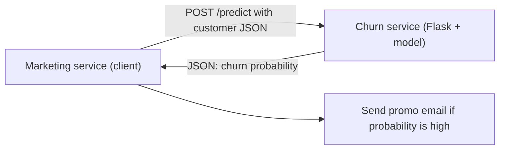
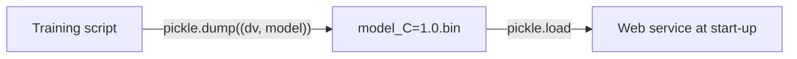
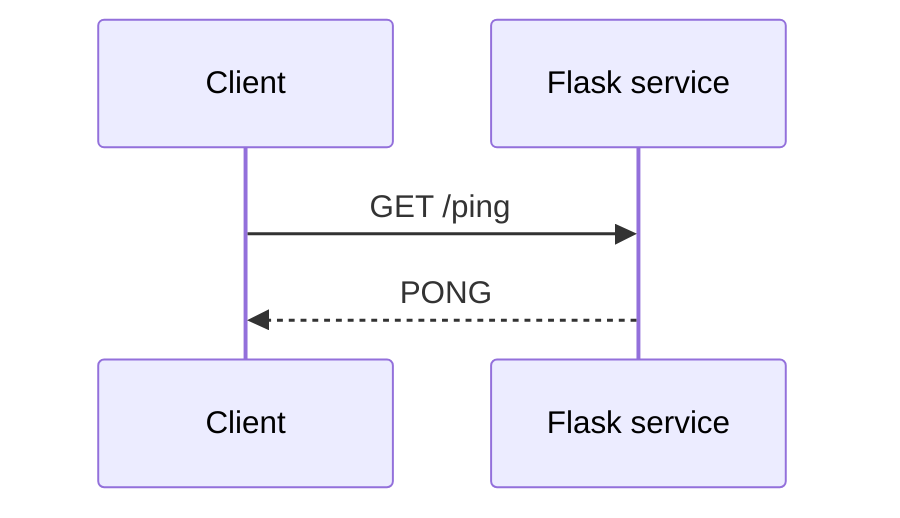
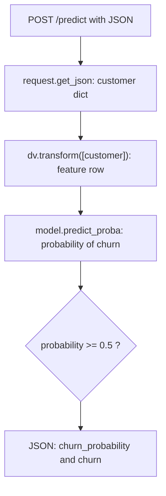
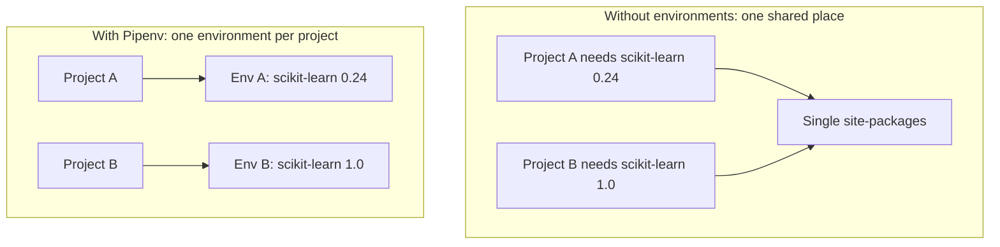
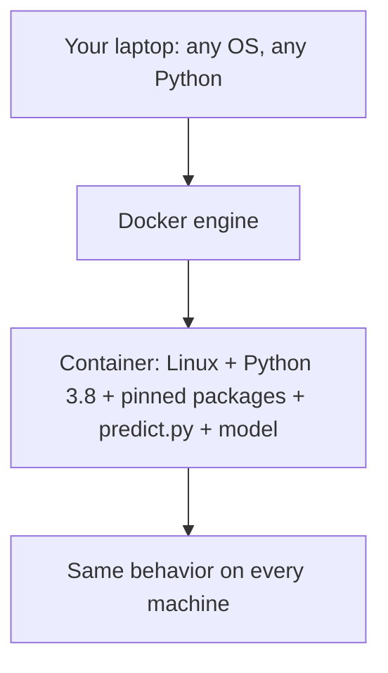
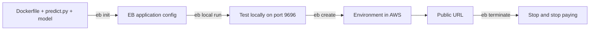

# Week 5: Deployment (Lessons 5.1 to 5.7)

**Module 5: Machine Learning Zoomcamp**

Lessons covered (optional AWS lesson included, summary / explore more / homework not included):

| Lesson | Topic | Source |
|--------|-------|--------|
| 5.1 | Intro: from notebook to web service | https://github.com/DataTalksClub/machine-learning-zoomcamp/blob/main/05-deployment/01-intro.md |
| 5.2 | Saving and loading the model (pickle) | https://github.com/DataTalksClub/machine-learning-zoomcamp/blob/main/05-deployment/02-pickle.md |
| 5.3 | Web services: introduction to Flask | https://github.com/DataTalksClub/machine-learning-zoomcamp/blob/main/05-deployment/03-flask-intro.md |
| 5.4 | Serving the churn model with Flask | https://github.com/DataTalksClub/machine-learning-zoomcamp/blob/main/05-deployment/04-flask-deployment.md |
| 5.5 | Python virtual environment: Pipenv | https://github.com/DataTalksClub/machine-learning-zoomcamp/blob/main/05-deployment/05-pipenv.md |
| 5.6 | Environment management: Docker | https://github.com/DataTalksClub/machine-learning-zoomcamp/blob/main/05-deployment/06-docker.md |
| 5.7 | Deployment to the cloud: AWS Elastic Beanstalk (optional) | https://github.com/DataTalksClub/machine-learning-zoomcamp/blob/main/05-deployment/07-aws-eb.md |

> Note on sources: the lesson pages were read through a summarizing fetch tool, not copied verbatim. The structure, commands, file names, port numbers and Dockerfile steps follow the lessons. The full code listings (train.py, predict.py, test script) are written out from those descriptions and the Module 3 churn project, so compare them with the lesson pages and the course videos before relying on every line.

> Python version: the lessons use Python 3.8 (Docker image `python:3.8.12-slim`). Use whatever version your own environment has, but keep it the same in Pipenv and in the Dockerfile.

---

## 1. The big picture (5.1)

In Module 3 we built a churn model. It lives in a notebook. Nobody else can use it. Deployment turns it into a **web service** that other programs can call.

Example: a marketing service sends customer data and gets back a churn probability. If the probability is high, it sends a promotion email.

Each step in this module removes one dependency on your own laptop:

| Step | What it removes |
|------|-----------------|
| Pickle + script | the notebook |
| Flask | the need to run code by hand |
| gunicorn | the development server |
| Pipenv | system-wide Python packages |
| Docker | the operating system and Python version |
| AWS Elastic Beanstalk | the local machine |

### Diagram: the whole module


### Diagram: who talks to whom



---

## 2. Terms explained

**Deployment**
Making a model available to real users or other programs, not just inside your notebook.

**Web service**
A program that waits for requests over HTTP and sends back responses. The caller does not need to know how it works inside.

**Client and server**
The client sends a request. The server answers it. Here the marketing service is the client and our Flask app is the server.

**HTTP**
The protocol of the web. Every request has a method, a URL and optionally a body.

**HTTP methods**
GET retrieves data. POST sends data to the server. PUT sends data to a specific location. DELETE removes data. We use GET for a health check and POST for sending a customer.

**Endpoint (route)**
A URL path that the service answers, like `/ping` or `/predict`.

**JSON**
A text format for structured data, like a Python dictionary. It is the usual language between services.

**Serialization**
Converting an object into bytes or text so it can be stored or sent. Pickle serializes Python objects. `jsonify` serializes a result to JSON.

**Pickle**
Python's built-in module to save any Python object to a file and load it back. It is in the standard library, so no install is needed.

**DictVectorizer**
The scikit-learn object from Module 3 that turns a customer dictionary into the numeric feature row the model expects. It was fitted on training data, so it has to be saved together with the model.

**Flask**
A small Python library for building web services.

**Development server vs production server**
`app.run()` starts Flask's built-in server, which is fine for testing but not for production. A production server such as gunicorn handles many requests safely and reliably.

**WSGI**
The standard interface between Python web apps and web servers. gunicorn and waitress are WSGI servers.

**Port**
A numbered door on a machine. Our service uses port 9696.

**localhost and 0.0.0.0**
`localhost` means "this machine only". `0.0.0.0` means "listen on all network interfaces", which is needed inside Docker so other machines can reach the service.

**Virtual environment**
A private set of Python packages for one project, so projects do not break each other.

**Pipfile and Pipfile.lock**
Pipfile lists the packages you asked for. Pipfile.lock pins the exact version (and hash) of every package, including sub-dependencies.

**Docker image and container**
An image is a packaged environment (OS, Python, libraries, your code). A container is a running copy of an image.

**Dockerfile**
A text recipe that tells Docker how to build an image.

**Port mapping**
`-p 9696:9696` connects a port on your machine to a port in the container.

**AWS Elastic Beanstalk (EB)**
An AWS service that starts servers, runs your container, keeps it alive, and scales it up and down with traffic.

---

## 3. 5.2 Saving and loading the model

### Why we save

After training we have two objects that only exist in the notebook's memory:

- `dv`, the fitted `DictVectorizer`
- `model`, the trained logistic regression

A web service must not retrain every time. We save both objects to a file and load them when the service starts. The vectorizer has to travel with the model: without it, a new customer cannot be turned into the same features the model was trained on.

### Diagram: save once, load many times



### Saving

```python
import pickle

output_file = f'model_C={C}.bin'

with open(output_file, 'wb') as f_out:
    pickle.dump((dv, model), f_out)
```

- `'wb'` means write binary. Pickle files are not text.
- We store a tuple `(dv, model)` so both objects are in one file.
- The file name contains `C`, so you can tell which hyperparameter produced it.

### Loading

```python
import pickle

with open('model_C=1.0.bin', 'rb') as f_in:
    dv, model = pickle.load(f_in)
```

`'rb'` means read binary. The tuple is unpacked back into `dv` and `model`.

### Security warning

Unpickling can run code. Only load pickle files you created yourself or fully trust. Never unpickle a file from an untrusted source.

### From notebook to script

The lesson moves the training steps into a script, `train.py`. A script can run on a server, on a schedule, or in a CI job, where Jupyter is not available.

```python
import pickle

import numpy as np
import pandas as pd

from sklearn.model_selection import train_test_split, KFold
from sklearn.feature_extraction import DictVectorizer
from sklearn.linear_model import LogisticRegression
from sklearn.metrics import roc_auc_score

# parameters
C = 1.0
n_splits = 5
output_file = f'model_C={C}.bin'

# data preparation
df = pd.read_csv('data-week-3.csv')

df.columns = df.columns.str.lower().str.replace(' ', '_')

categorical_columns = list(df.dtypes[df.dtypes == 'object'].index)
for c in categorical_columns:
    df[c] = df[c].str.lower().str.replace(' ', '_')

df.totalcharges = pd.to_numeric(df.totalcharges, errors='coerce')
df.totalcharges = df.totalcharges.fillna(0)

df.churn = (df.churn == 'yes').astype(int)

df_full_train, df_test = train_test_split(df, test_size=0.2, random_state=1)

numerical = ['tenure', 'monthlycharges', 'totalcharges']

categorical = [
    'gender', 'seniorcitizen', 'partner', 'dependents',
    'phoneservice', 'multiplelines', 'internetservice',
    'onlinesecurity', 'onlinebackup', 'deviceprotection',
    'techsupport', 'streamingtv', 'streamingmovies',
    'contract', 'paperlessbilling', 'paymentmethod',
]


def train(df_train, y_train, C=1.0):
    dicts = df_train[categorical + numerical].to_dict(orient='records')

    dv = DictVectorizer(sparse=False)
    X_train = dv.fit_transform(dicts)

    model = LogisticRegression(C=C, max_iter=1000)
    model.fit(X_train, y_train)

    return dv, model


def predict(df, dv, model):
    dicts = df[categorical + numerical].to_dict(orient='records')

    X = dv.transform(dicts)
    y_pred = model.predict_proba(X)[:, 1]

    return y_pred


# validation
print(f'doing validation with C={C}')

kfold = KFold(n_splits=n_splits, shuffle=True, random_state=1)

scores = []

for train_idx, val_idx in kfold.split(df_full_train):
    df_train = df_full_train.iloc[train_idx]
    df_val = df_full_train.iloc[val_idx]

    y_train = df_train.churn.values
    y_val = df_val.churn.values

    dv, model = train(df_train, y_train, C=C)
    y_pred = predict(df_val, dv, model)

    auc = roc_auc_score(y_val, y_pred)
    scores.append(auc)

print('C=%s %.3f +- %.3f' % (C, np.mean(scores), np.std(scores)))

# training the final model
print('training the final model')

y_full_train = df_full_train.churn.values
dv, model = train(df_full_train, y_full_train, C=1.0)

y_pred = predict(df_test, dv, model)
y_test = df_test.churn.values

auc = roc_auc_score(y_test, y_pred)
print(f'auc={auc}')

# save the model
with open(output_file, 'wb') as f_out:
    pickle.dump((dv, model), f_out)

print(f'the model is saved to {output_file}')
```

Run it with:

```bash
python train.py
```

Notes:

- The data file name must match the one you used in Module 3. On pandas 3 the check `df.dtypes == 'object'` can return nothing. If `categorical_columns` is empty, use `df.select_dtypes(include=['object', 'string']).columns` instead.
- The AUC of the final model on the test set is printed once, the same idea as in Module 4.

---

## 4. 5.3 Web services: introduction to Flask

### What a web service is

Applications talk to each other over HTTP. A client sends a request to a URL, and the server sends back a response.

### Diagram: request and response



### The ping service

The smallest possible service. One GET route, `/ping`, which answers `PONG`. It is a health check: if it answers, the service is alive.

File `ping.py`:

```python
from flask import Flask

app = Flask('ping')


@app.route('/ping', methods=['GET'])
def ping():
    return 'PONG'


if __name__ == '__main__':
    app.run(debug=True, host='0.0.0.0', port=9696)
```

How it works:

- `Flask('ping')` creates the app. The name is just a label.
- `@app.route('/ping', methods=['GET'])` is a **decorator**. It tells Flask: "when someone sends a GET request to `/ping`, call the function below".
- `host='0.0.0.0'` makes the service reachable from other machines, not only localhost.
- `port=9696` is the port it listens on.
- `debug=True` restarts the server when the code changes and shows detailed errors. Use it only while developing.

### Running and testing

Install Flask once:

```bash
pip install flask
```

Start the service:

```bash
python ping.py
```

Test it from another terminal:

```bash
curl http://localhost:9696/ping
```

Output:

```
PONG
```

You can also open `http://localhost:9696/ping` in a browser. A browser sends GET requests, which is why this works.

### HTTP methods cheat sheet

| Method | Meaning | Used here for |
|--------|---------|---------------|
| GET | retrieve data | `/ping` health check |
| POST | send data to the server | `/predict` with a customer |
| PUT | send data to a specific location | not used |
| DELETE | remove data | not used |

---

## 5. 5.4 Serving the churn model with Flask

### The design

- Load the model **once** when the service starts, not on every request.
- A `/predict` route accepts **POST** requests with customer data as JSON.
- Turn the customer into features with `dv`, then get the churn probability from the model.
- Compare it with a threshold of 0.5 to get a yes/no answer.
- Send back JSON.

### Diagram: inside the /predict route



### The service

File `predict.py`:

```python
import pickle

from flask import Flask, request, jsonify

model_file = 'model_C=1.0.bin'

with open(model_file, 'rb') as f_in:
    dv, model = pickle.load(f_in)

app = Flask('churn')


@app.route('/predict', methods=['POST'])
def predict():
    customer = request.get_json()

    X = dv.transform([customer])
    y_pred = model.predict_proba(X)[0, 1]
    churn = y_pred >= 0.5

    result = {
        'churn_probability': float(y_pred),
        'churn': bool(churn),
    }

    return jsonify(result)


if __name__ == '__main__':
    app.run(debug=True, host='0.0.0.0', port=9696)
```

Details:

- `request.get_json()` reads the JSON body of the POST request and returns a Python dictionary.
- `dv.transform([customer])` needs a **list** of dictionaries, so the single customer goes into a one-element list.
- `predict_proba(X)` returns two columns, `[P(no churn), P(churn)]`. `[0, 1]` takes row 0, column 1: the probability of churn.
- `float(...)` and `bool(...)` are needed because NumPy types (`numpy.float64`, `numpy.bool_`) cannot be turned into JSON.
- `jsonify` builds the HTTP response with the right JSON headers.

### Testing with a client script

A browser cannot test this route, because it sends GET requests and `/predict` accepts only POST. We write a small client with the `requests` library.

File `predict-test.py`:

```python
import requests

url = 'http://localhost:9696/predict'

customer = {
    'gender': 'female',
    'seniorcitizen': 0,
    'partner': 'yes',
    'dependents': 'no',
    'phoneservice': 'no',
    'multiplelines': 'no_phone_service',
    'internetservice': 'dsl',
    'onlinesecurity': 'no',
    'onlinebackup': 'yes',
    'deviceprotection': 'no',
    'techsupport': 'no',
    'streamingtv': 'no',
    'streamingmovies': 'no',
    'contract': 'month-to-month',
    'paperlessbilling': 'yes',
    'paymentmethod': 'electronic_check',
    'tenure': 1,
    'monthlycharges': 29.85,
    'totalcharges': 29.85,
}

response = requests.post(url, json=customer).json()
print(response)

if response['churn']:
    print('sending promo email')
else:
    print('not sending promo email')
```

Run the service in one terminal and the client in another:

```bash
python predict.py
```

```bash
python predict-test.py
```

For this customer the lesson gets a churn probability of about 0.33 and `churn = False`, so no promo email is sent.

Notes:

- `requests.post(url, json=customer)` converts the dictionary to JSON and sets the header for you.
- The customer keys must match the cleaned column names from training: lowercase, with underscores instead of spaces.

### A production server: gunicorn

When you run `python predict.py`, Flask warns: "This is a development server. Do not use it in a production deployment."

Use a WSGI server instead.

Linux and macOS, gunicorn:

```bash
pip install gunicorn
gunicorn --bind=0.0.0.0:9696 predict:app
```

Windows, waitress (gunicorn does not run on Windows):

```bash
pip install waitress
waitress-serve --listen=0.0.0.0:9696 predict:app
```

`predict:app` means: take the file `predict.py` (module `predict`) and the Flask object named `app` inside it. If you rename the file or the variable, change this too.

With gunicorn the `if __name__ == '__main__'` block is not used. The same `predict-test.py` works against it.

---

## 6. 5.5 Python virtual environment: Pipenv

### The problem

`pip install` puts packages in one shared place for the whole system. Two projects that need different versions of the same library, for example scikit-learn 0.24 and 1.0, break each other. A pickled model can also fail to load if the scikit-learn version differs from the one that saved it.

### The fix: one environment per project

A virtual environment gives each project its own private set of packages. We use **Pipenv** because it also records the exact versions.

### Diagram: shared vs isolated



### Setup

Install Pipenv once:

```bash
pip install pipenv
```

In the project folder, install the dependencies:

```bash
pipenv install numpy scikit-learn flask gunicorn
```

Pin the scikit-learn version to the one used for training, for example `scikit-learn==1.0.2`, so the pickled model loads correctly.

This creates two files:

| File | What it holds |
|------|---------------|
| `Pipfile` | the packages you asked for and the versions requested |
| `Pipfile.lock` | the exact version and hash of every package, including sub-dependencies |

Commit both files to git.

### Reproducing the environment

On another machine, or after cloning the repo:

```bash
pipenv install
```

It rebuilds the environment from `Pipfile.lock`.

### Running inside the environment

Option 1, open a shell that uses the environment:

```bash
pipenv shell
gunicorn --bind localhost:9696 predict:app
```

Type `exit` to leave the shell.

Option 2, run one command without activating the shell:

```bash
pipenv run gunicorn --bind localhost:9696 predict:app
```

### Limit of Pipenv

Pipenv pins Python packages. It does not pin the Python version itself or system libraries (the operating system). Docker covers that.

---

## 7. 5.6 Environment management: Docker

### Why Docker

Pipenv isolates packages but not the operating system or the Python interpreter. Docker packs the application together with its whole environment into an **image**. Anyone who runs the image gets exactly the same setup.

### Diagram: layers of isolation



### Installing Docker

- Ubuntu: `sudo apt-get install docker.io`
- Windows and macOS: install Docker Desktop (see the Docker documentation).

Check it works:

```bash
docker run hello-world
```

### The Dockerfile

File named `Dockerfile` (no extension):

```dockerfile
FROM python:3.8.12-slim

RUN pip install pipenv

WORKDIR /app

COPY ["Pipfile", "Pipfile.lock", "./"]

RUN pipenv install --system --deploy

COPY ["predict.py", "model_C=1.0.bin", "./"]

EXPOSE 9696

ENTRYPOINT ["gunicorn", "--bind=0.0.0.0:9696", "predict:app"]
```

Line by line:

| Instruction | What it does |
|-------------|--------------|
| `FROM python:3.8.12-slim` | start from an image with Python 3.8.12 on a small Linux |
| `RUN pip install pipenv` | install Pipenv inside the image |
| `WORKDIR /app` | create `/app` and use it as the working folder |
| `COPY Pipfile, Pipfile.lock` | copy the dependency files first |
| `RUN pipenv install --system --deploy` | install the locked packages into the image's system Python, with no extra virtualenv. `--deploy` fails if `Pipfile.lock` is out of date |
| `COPY predict.py, model` | copy the service code and the saved model |
| `EXPOSE 9696` | document that the container listens on port 9696 |
| `ENTRYPOINT [...]` | the command that runs when the container starts: gunicorn serving the Flask app |

Why copy the Pipfiles before the code: Docker caches each step. If only `predict.py` changes, the slow package installation step is reused from the cache.

### Build and run

Build the image and name it `churn-prediction`:

```bash
docker build -t churn-prediction .
```

Run it:

```bash
docker run -it -p 9696:9696 churn-prediction:latest
```

- `-it` runs interactively, so you see the logs and can stop with Ctrl+C.
- `-p 9696:9696` maps port 9696 on your machine to port 9696 in the container. Without it the service runs but you cannot reach it.

Now `predict-test.py` works unchanged against `http://localhost:9696/predict`.

### Useful options

| Option | Meaning |
|--------|---------|
| `--rm` | remove the container when it stops, so stopped containers do not pile up |
| `--entrypoint=bash` | open a shell inside the container instead of starting the service (good for debugging) |

Example:

```bash
docker run -it --rm --entrypoint=bash churn-prediction:latest
```

### Common problems

- `predict:app` must match your file and variable names. If your files are called `churn_serving.py` and `churn-model.bin`, change the `COPY` line and the `ENTRYPOINT` accordingly.
- The service must listen on `0.0.0.0`, not `localhost`, inside the container.
- The port in `-p` must match the port gunicorn uses.

---

## 8. 5.7 Deployment to the cloud: AWS Elastic Beanstalk (optional)

### What it does

Elastic Beanstalk (EB) starts the servers, runs your Docker container, keeps it healthy, and adds or removes containers with traffic. Our marketing service sends requests to the EB URL. EB forwards them to the Flask app in the container and returns the churn probability.

### Diagram: deployment flow



### Steps

You need an AWS account and AWS credentials configured on your machine.

**1. Install the EB command line tool as a dev dependency.** The container does not need it, so it goes in the `--dev` group:

```bash
pipenv install awsebcli --dev
```

Then work inside the environment:

```bash
pipenv shell
```

**2. Initialize the EB application.** Choose the Docker platform, a region, and an app name:

```bash
eb init -p docker -r eu-north-1 churn-serving
```

This creates `.elasticbeanstalk/config.yml`. Take a look at it. Use the region closest to you.

**3. Test locally before deploying:**

```bash
eb local run --port 9696
```

Run `predict-test.py` against `http://localhost:9696/predict`.

**4. Create the cloud environment:**

```bash
eb create churn-serving-env
```

It takes a few minutes and ends with a public URL. In `predict-test.py`, set the URL to that address, **without** the port number:

```python
url = 'http://churn-serving-env.xxxxxxxxxx.eu-north-1.elasticbeanstalk.com/predict'
```

The address above is a placeholder. Use the one that EB prints.

**5. Terminate when you finish:**

```bash
eb terminate churn-serving-env
```

AWS charges for a running environment, so do not forget this step.

### Cautions

- The environment URL is **public**. Anyone who finds it can call the service. Real production use needs authentication or network access rules.
- Configure your AWS credentials before running EB commands.
- Always terminate the environment after the exercise.

---

## 9. End-to-end command cheat sheet

| Goal | Command |
|------|---------|
| Train and save the model | `python train.py` |
| Run the dev server | `python predict.py` |
| Run gunicorn (Linux, macOS) | `gunicorn --bind=0.0.0.0:9696 predict:app` |
| Run waitress (Windows) | `waitress-serve --listen=0.0.0.0:9696 predict:app` |
| Test the service | `python predict-test.py` |
| Install into a Pipenv environment | `pipenv install numpy scikit-learn flask gunicorn` |
| Recreate the environment | `pipenv install` |
| Enter the environment | `pipenv shell` |
| Run one command in the environment | `pipenv run <command>` |
| Build the image | `docker build -t churn-prediction .` |
| Run the container | `docker run -it -p 9696:9696 churn-prediction:latest` |
| Debug shell in the image | `docker run -it --rm --entrypoint=bash churn-prediction:latest` |
| EB init | `eb init -p docker -r eu-north-1 churn-serving` |
| EB local test | `eb local run --port 9696` |
| EB deploy | `eb create churn-serving-env` |
| EB shut down | `eb terminate churn-serving-env` |

---

## 10. Key takeaways

- Deployment means turning a notebook model into a **web service** other programs can call.
- **Pickle** saves the trained objects. Save the `DictVectorizer` together with the model, and never unpickle files you do not trust.
- Move the training code into a **script** (`train.py`) so it can run without Jupyter.
- **Flask** exposes the model: GET `/ping` for a health check, POST `/predict` with JSON for predictions.
- Load the model once at start-up. Convert NumPy values with `float()` and `bool()` before `jsonify`.
- Flask's built-in server is for development only. Use **gunicorn** (or **waitress** on Windows) with `module:app`.
- **Pipenv** gives each project its own packages and pins exact versions in `Pipfile.lock`. Keep the scikit-learn version the same as in training.
- **Docker** also pins the operating system and the Python version. Copy the Pipfiles first to use the build cache, and map the port with `-p`.
- **Elastic Beanstalk** puts the container on the internet: `eb init`, `eb local run`, `eb create`, and `eb terminate` when done.

---

## 11. Navigation

- Previous: Module 4, evaluation metrics
- Next: Module 6, decision trees and ensemble learning
